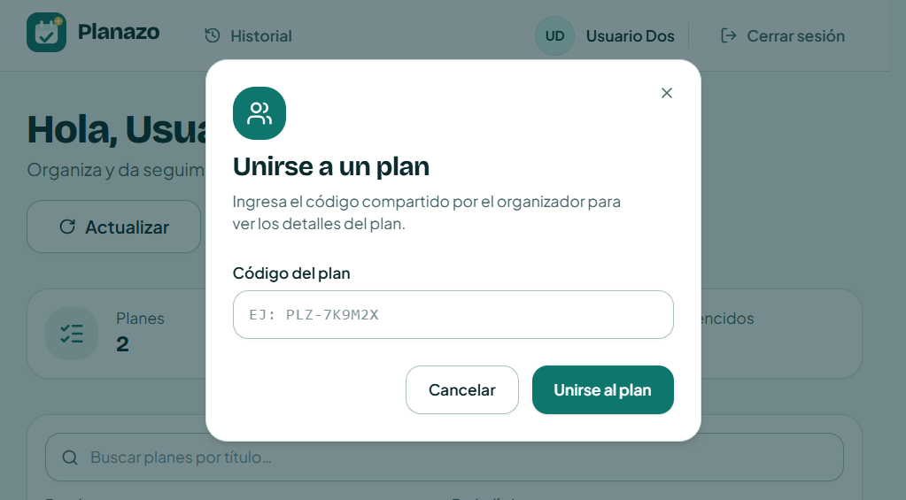
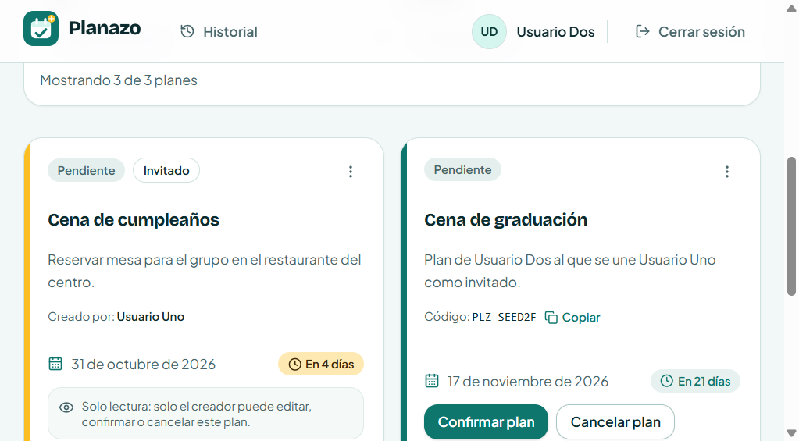

# Clase 17 — Análisis del proyecto recibido

## Proyecto recibido

Me tocó Planazo. Lo hizo Erick Raul Teran Tabera y Moises David Cisneros Laura. El repo de ellos es https://github.com/moises-cisneros/Proyecto-2-IHC.git y nosotros estamos en la copia https://github.com/DSaav22/Proyecto-2-IHC-Cambiaso.git. En `docs/project-card.md` el propósito es ayudar a un grupo a organizar un plan.

Ya viene con login, planes (pendiente, confirmado, cancelado), un código para compartir y la opción de unirse a un plan de otra persona. Eso sí se guarda. Lo de la Tarea 5 no está: invitar gente, proponer fechas o lugares y votar una opción.

## Recorrido

Seguí el caso de unirse con código, que es lo más parecido a tener varias personas en el mismo plan. Usuario Dos entra a "Cena de cumpleaños", que es de Usuario Uno, con el código `PLZ-SEED2A`.

En la diapositiva ponían `PlanDetail`, `handleVote()`, `canVote()` y `votesRepository`. Acá no existen esos nombres. El camino real es este.

La pantalla es `/mis-planes`. El botón "Unirse con código" está en `apps/frontend/src/pages/MyPlansPage.tsx` (líneas 180-191) y abre `JoinPlanDialog.tsx`. Ahí escribís el código, lo pasa a mayúsculas, y si lo dejás vacío dice "Ingresa el código del plan." y no manda nada.

Ese diálogo no pega al servidor solo. Le pasa el código a `handleJoin` (mismo archivo, líneas 99-106). `handleJoin` llama a `joinPlan` en `apps/frontend/src/hooks/usePlans.ts` (114-126) y el hook usa `api.joinPlan` de `apps/frontend/src/api/client.ts` (línea 141). La petición es `POST /api/plans/join` con `{ code }`. Si sale bien, el plan aparece en la lista y muestra "Te has unido al plan correctamente."

La ruta está en `apps/backend/src/routes/plans.ts`, líneas 136-163. Ahí casi no hay regla: revisa el body y devuelve el status. Lo que decide si te podés unir es `joinByCode`, en `apps/backend/src/services/plans.service.ts`, líneas 267-308. Recorta el código y lo pone en mayúsculas. Si el código no existe, "Plan no encontrado con este código" (404). Si sos el creador, "Ya eres el creador de este plan" (400). Si ya estabas unido, "Ya te has unido a este plan" (409). Si pasa eso, crea el `PlanMember`.

El invitado ve la tarjeta pero no puede confirmar, cancelar ni borrar. Eso lo corta `ForbiddenPlanActionError`. En la pantalla dice "Solo lectura: solo el creador puede editar, confirmar o cancelar este plan."

Los datos quedan en PostgreSQL, en `apps/backend/prisma/schema.prisma`. `Plan` (líneas 24-38) tiene título, descripción, una sola fecha (`dueDate`), estado y `shareCode`. `PlanMember` (líneas 40-50) guarda quién se unió a qué plan. No se puede repetir la misma persona en el mismo plan. Al unirse también deja una actividad `joined`.

La fecha la pone el creador cuando crea el plan. No hay varias fechas ni lugares, y nadie vota.

Los tests de esto están en `apps/backend/src/routes/plans.test.ts`, bloque "POST /api/plans/join and guest permissions", desde la línea 670. El diálogo lo prueba `JoinPlanDialog.test.tsx`. Si después movemos archivos, hay que correr estos tests antes y después para ver que unirse sigue igual. Para votar van a hacer falta otros, porque estos no cubren eso.

## Ejecución

Las capturas son de la app abierta, no del test. El test no muestra la pantalla.

En el README el comando es `pnpm dev`, y eso levanta todo con Docker. Yo lo corrí sin Docker, porque PostgreSQL 17 ya estaba en el puerto 5432 con la base `planazo_db`. Primero las dependencias, las migraciones y el seed (el `DATABASE_URL` está en `apps/backend/.env`):

```bash
corepack pnpm install
corepack pnpm --filter backend exec prisma migrate deploy
corepack pnpm --filter backend exec prisma db seed
corepack pnpm --filter backend dev
```

La API queda en http://localhost:3000. En otra terminal el front, apuntando a esa API (si no, Vite busca el host `backend`, que solo existe dentro de Docker):

```bash
$env:VITE_API_PROXY_TARGET = "http://localhost:3000"
corepack pnpm --filter frontend dev
```

El front queda en http://localhost:5173. Con eso entré y saqué las capturas.

Aparte corrí el test de la regla, para comprobar el caso antes de tocar nada. No reemplaza lo de arriba:

```bash
corepack pnpm --filter backend exec vitest run src/routes/plans.test.ts -t "POST /api/plans/join"
```

Vitest 5.0.3, 27 de octubre, 22:09:

```text
Test Files  1 passed (1)
     Tests  9 passed | 48 skipped (57)
  Duration  11.61s
```

Pasaron 9, que son los de unirse y los permisos del invitado. Los 48 skipped están en el mismo archivo pero el filtro no los toma.

Después lo probé en el navegador. Entré con `usuario2@planazo.com` / `Planazo123!`, en Mis planes le di a "Unirse con código" y puse `PLZ-SEED2A`. Ese código es el de Cena de cumpleaños y está en `apps/backend/src/lib/demoPlans.ts`. Le di a "Unirse al plan" y después recargué.

La tarjeta salió con "Invitado" y "Creado por: Usuario Uno". Antes había 2 planes y pasó a 3. Al recargar seguía. En la base también:

```text
       miembro        | shareCode  |       titulo
----------------------+------------+--------------------
 usuario2@planazo.com | PLZ-SEED2A | Cena de cumpleaños
(1 fila)
```

El diálogo:



Apenas se unió. A la izquierda el plan de Usuario Uno (solo lectura) y a la derecha uno propio de Usuario Dos, con Confirmar y Cancelar:


Después de recargar. Siguen los 3 planes y Cena de cumpleaños sigue como invitado:



## Impacto para la Tarea 5

La tarea de Planazo es invitar participantes, proponer fechas o lugares y votar una opción. Tiene que quedar guardado si recargás o volvés a entrar.

Unirse con código ya se guarda en `PlanMember`, por eso al recargar no se pierde. Si el voto queda solo en el estado de React, al recargar se va. Hay que guardarlo en la base, como la membresía.

Esto no es un refactor ni un bug. Unirse con código funciona. Votar es algo que el proyecto todavía no tiene, o sea funcionalidad nueva. Si antes de eso movemos código para que no quede todo amontonado en `MyPlansPage`, eso sí sería refactor, y los tests de join tienen que seguir en verde.

Hoy todo se ve en las tarjetas de `MyPlansPage.tsx`. No hay una pantalla de detalle. Para invitar, proponer y votar haría falta un lugar en la tarjeta o una vista del plan. `handleJoin` solo manda el código, así que esas acciones van aparte. `joinByCode` solo dice si te podés unir. Falta quién invita, quién propone, que cada uno vote una vez y cuál opción gana. No hay un `canVote`.

En datos el plan tiene una sola `dueDate`. Habría que agregar en `schema.prisma` algo para la invitación, la propuesta (fecha o lugar) y el voto, y una migración. Al volver a entrar se leen de ahí.

Los archivos, cuando lo hagamos: `schema.prisma` y `apps/backend/prisma/migrations`, la regla en `plans.service.ts` (o un servicio aparte si se mezcla mucho con crear y confirmar), la validación en `apps/backend/src/lib/schemas.ts`, rutas en `apps/backend/src/routes/plans.ts` con la misma sesión, y en el front `client.ts`, `usePlans.ts`, `PlanCard.tsx` y `MyPlansPage.tsx`.

Ojo con el texto de solo lectura. El invitado hoy no puede confirmar ni borrar, y eso está bien que siga así. Pero para la tarea sí tendría que poder votar. Son dos cosas distintas.

Los 9 tests de join se vuelven a correr si tocamos esa parte. Lo de votar necesita tests nuevos. Unirse con `PLZ-SEED2A` tiene que seguir creando el `PlanMember`, mostrar "Invitado" y aguantar la recarga. Confirmar y cancelar siguen siendo del creador. La fecha que ya tiene el plan la carga él al crearlo; las propuestas de la Tarea 5 van por otro lado.
