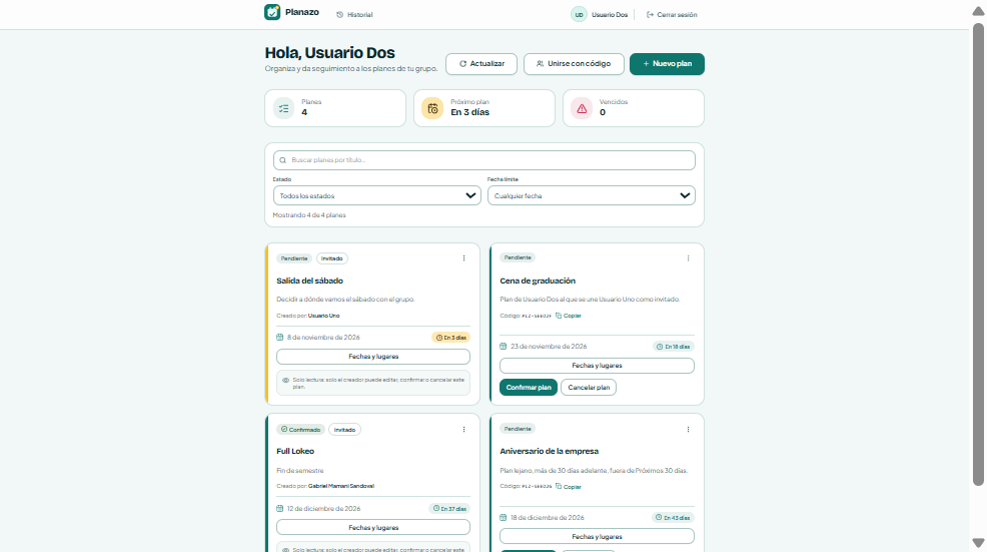
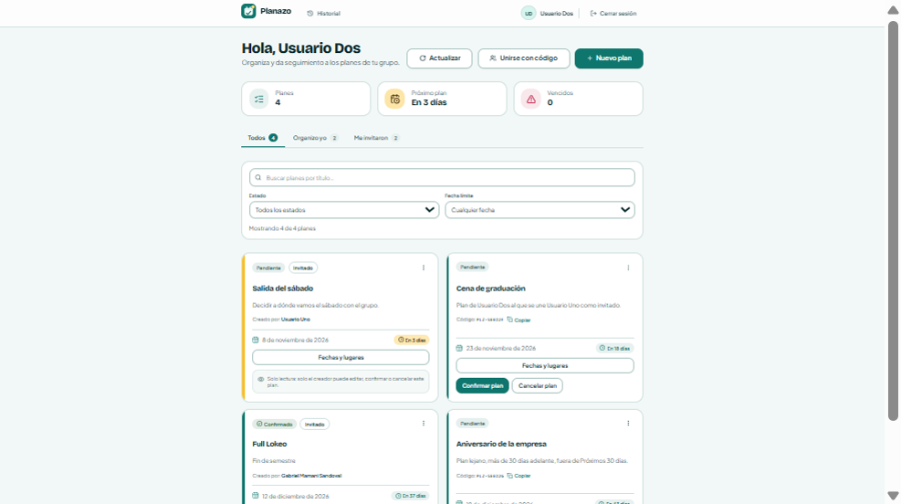
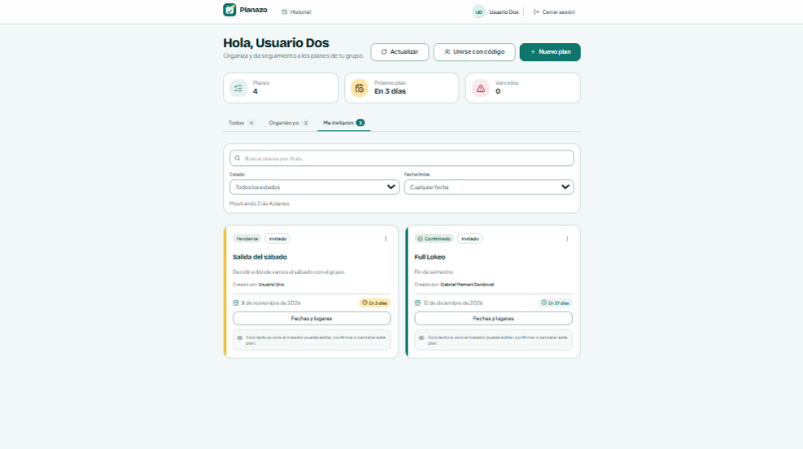

# Clase 20 — Arquitectura de información

## Integrantes

- Diego Joaquín Saavedra Alberto

## Problema

En Planazo todo cae en una sola lista, "Mis planes". Ahí están mezclados los planes que creé yo y los planes de otras personas a los que me uní con código. La única forma de distinguirlos es leer tarjeta por tarjeta y buscar la etiqueta "Invitado" o el texto "Creado por: …".

La tarea que cuesta es esta:

> «Entra como Usuario Dos y encuentra los planes a los que te invitaron para votar una fecha».

Con Usuario Dos hay 4 planes: 2 suyos ("Cena de graduación", "Aniversario de la empresa") y 2 de otros ("Salida del sábado" de Usuario Uno y "Full Lokeo" de Gabriel). En la lista aparecen intercalados por fecha, así que hay que recorrer las 4 tarjetas para saber cuáles son ajenos. Los filtros que ya existen (título, estado, fecha límite) no ayudan, porque ninguno separa por rol.

## Propuesta

Separar "Mis planes" en tres secciones según el rol de la persona en cada plan. Las secciones van arriba de los filtros, porque son navegación y no un filtro más:

```text
┌──────────────────────────────────────────────────────────────┐
│ Hola, Usuario Dos        [Actualizar] [Unirse con código] [+] │
│ [Planes 4]   [Próximo plan]   [Vencidos 0]                   │
│                                                              │
│  Todos (4) │ Organizo yo (2) │ Me invitaron (2)    ← secciones│
│ ─────────────────────────────────────────────                │
│ ┌ Filtros ───────────────────────────────────────┐           │
│ │ Buscar…   Estado ▾   Fecha límite ▾            │ ← filtros │
│ │ Mostrando 2 de 4 planes                        │           │
│ └────────────────────────────────────────────────┘           │
│ [Salida del sábado · Invitado] [Full Lokeo · Invitado]       │
└──────────────────────────────────────────────────────────────┘
```

- **Todos:** lo mismo que antes, para no perder la vista completa.
- **Organizo yo:** planes que creé. Ahí están los botones de confirmar, cancelar, editar y el código para compartir.
- **Me invitaron:** planes de otras personas. Ahí solo puedo votar fechas y lugares o abandonar el plan.

Cada sección muestra cuántos planes tiene, para que se sepa antes de entrar si hay algo.

## Motivo

Lo pensamos con las tres preguntas de la clase:

- **¿Qué busca?** Los planes donde me toca participar (votar), no los que tengo que administrar. Son dos tareas distintas, y antes estaban en la misma lista.
- **¿Cómo lo llama?** "Me invitaron" usa la misma palabra que la etiqueta "Invitado" de la tarjeta. Así el nombre de la sección y la etiqueta significan lo mismo. "Organizo yo" anticipa que ahí están los planes que se pueden editar y confirmar.
- **¿Dónde lo espera?** Arriba de la lista, como pestañas, y no como una opción más dentro del filtro de Estado. Un filtro acota "qué planes"; la sección dice "de quién es el plan". Por eso "Limpiar filtros" no cambia la sección.

Se mantiene el contexto al volver atrás. La sección queda en la URL (`/mis-planes?vista=invitado`), junto con los filtros, así que recargar o usar el botón atrás del navegador te deja en el mismo lugar.

Son tres opciones fijas, pocas para elegir de un vistazo. "Todos" sigue siendo la vista por defecto para que nadie pierda planes al entrar.

## Antes y después

Antes: los 4 planes mezclados. Hay que leer cada tarjeta para encontrar "Invitado".



Después, en "Todos": aparecen las secciones con su cantidad, encima de los filtros.



Después, en "Me invitaron": quedan solo los 2 planes de otras personas. El contador de abajo dice "Mostrando 2 de 4 planes".



## Implementación

Solo se tocó el frontend. El backend ya mandaba `isOwner` en cada plan, así que no hizo falta cambiar la API ni la base.

- `apps/frontend/src/lib/planSections.ts`: las tres secciones, cómo se leen de la URL (`vista`) y cómo se filtran y cuentan los planes. Un plan sin `isOwner` se toma como propio, igual que hace `PlanCard`.
- `apps/frontend/src/components/domain/PlanSectionTabs.tsx`: las pestañas. Son enlaces dentro de un `nav` con `aria-current="page"` en la sección activa y altura mínima de 44 px.
- `apps/frontend/src/pages/MyPlansPage.tsx`: lee la sección de la URL, la conserva al cambiar o limpiar filtros, y si una sección queda vacía muestra un mensaje en vez de la lista.

Tests (Vitest):

- `planSections.test.ts`: 10 tests de la lógica (leer la URL, valores inválidos, filtrar, contar).
- `MyPlansPage.test.tsx`: 2 tests nuevos. Cambiar de sección muestra solo los planes que corresponden y cambia la URL. Limpiar filtros mantiene la sección.

```bash
corepack pnpm --filter frontend exec vitest run
```

```text
Test Files  19 passed (19)
     Tests  232 passed (232)
```

## Prueba con otra persona

**No se pudo hacer.** La clase fue virtual y no hubo compañeros de otro grupo disponibles para resolver la tarea sin indicaciones. No registramos un resultado de "sin ayuda / con ayuda / no lo encontró" porque no hubo prueba.

Lo que sí hicimos fue recorrer la tarea nosotros en la app abierta, con `usuario2@planazo.com`:

| Paso | Antes | Después |
| --- | --- | --- |
| Encontrar los planes a los que me invitaron | Leer las 4 tarjetas una por una | Un clic en "Me invitaron" |
| Saber cuántos son sin entrar | No se puede | El contador de la pestaña dice 2 |
| Recargar la página | — | Sigue en "Me invitaron" (`?vista=invitado`) |

Queda pendiente repetir la tarea con alguien de otro grupo, sin decirle qué pestaña abrir, y anotar dónde duda.

### Commit

SHA: 6f56000507eb4a96c8e1417e37051be851cbb7db

[feat(frontend): separar Mis planes en secciones por rol · DSaav22/Proyecto-2-IHC-Cambiaso@6f56000](https://github.com/DSaav22/Proyecto-2-IHC-Cambiaso/commit/6f56000507eb4a96c8e1417e37051be851cbb7db)