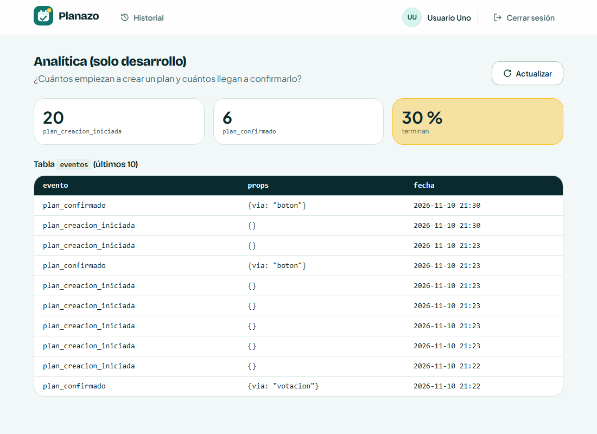

# Clase 21 — Analítica de interacción

## Integrantes

- Diego Joaquín Saavedra Alberto

Modalidad: con IA.

## Pregunta

¿Cuántas personas que empiezan a crear un plan llegan a confirmarlo?

## Eventos

| Evento | Cuándo se guarda | Props |
| --- | --- | --- |
| `plan_creacion_iniciada` | Al abrir "Nuevo plan" | ninguna |
| `plan_confirmado` | Después de que el plan se confirmó en el servidor | `via`: `boton` o `votacion` |

`plan_confirmado` va después del `await` que confirma. Si la confirmación falla, el código no llega a esa línea y no se guarda nada, así que cada registro es un plan confirmado de verdad.

Uso `via` porque en Planazo un plan se confirma de dos formas: con el botón de la tarjeta o al cerrar la votación de fechas y lugares. Quiero saber cuál usa más la gente.

Dónde está el `track()`:

- `apps/frontend/src/pages/MyPlansPage.tsx:133` (inicio)
- `apps/frontend/src/hooks/usePlans.ts:149` (confirmar con el botón)
- `apps/frontend/src/hooks/usePlanCoordination.ts:60` (confirmar al cerrar la votación)

## Dónde se guardan

En una tabla nueva `eventos`, en la misma base de la app, con tres columnas: evento, props y fecha.

El backend solo acepta estos dos eventos con esas props (`apps/backend/src/lib/analytics.ts`). Si llega otro evento o una prop de más, como un correo, responde 400 y no guarda nada.

## Qué no guardo y por qué

- **Quién lo hizo (nombre, correo, id):** la pregunta cuenta planes, no personas.
- **Título y descripción del plan:** los escribe el usuario y no ayudan a responder la pregunta.
- **Código para compartir:** sirve para entrar a un plan ajeno.

## Panel `/analitica`

Solo funciona en desarrollo. Muestra cuántos hay de cada evento, el % que termina y la tabla `eventos` con los últimos 10 registros.



Los datos son de mis pruebas locales: 20 empezaron, 6 confirmaron, 30 %.

## Decisión

Solo 3 de cada 10 planes que se empiezan llegan a confirmarse. Una parte es normal, porque muchos planes esperan a que el grupo vote. Pero con dos eventos no sé en qué paso se pierde la gente. Para la Tarea 9 agregaría eventos en los pasos del medio (plan creado, opción propuesta, voto) para encontrar la mayor caída.

## Pruebas

- `MyPlansPage.test.tsx`: abrir "Nuevo plan" guarda `plan_creacion_iniciada` una sola vez y sin datos personales.
- `usePlans.test.tsx`: confirmar con el botón guarda `plan_confirmado` con `via: "boton"`; si falla, no guarda nada.
- `PlanCoordinationDialog.test.tsx`: confirmar al cerrar la votación guarda `plan_confirmado` con `via: "votacion"`.
- `apps/backend/src/lib/analytics.test.ts`: el backend rechaza eventos desconocidos y props con datos personales.
- `tests/analytics.spec.ts` (E2E): crea y confirma un plan, revisa que salieron los dos eventos sin nombre, correo ni título, y que aparecen en la tabla de `/analitica`.

## Cómo correrlas

```bash
corepack pnpm --filter backend exec prisma migrate deploy
corepack pnpm --filter backend exec vitest run
corepack pnpm --filter frontend exec vitest run
corepack pnpm test:e2e
```

## Resultados

- Backend: 225 de 225.
- Frontend: 241 de 241.
- E2E: todas pasan. La comparación visual de los errores del login falló una vez por 18 píxeles cuando corrían todas juntas; sola pasa.

También arreglé las pruebas que fallaban desde la Tarea 7: las E2E de votación todavía buscaban textos viejos del diálogo, y un test usaba una fecha fija que ya pasó.

## Commits

- Pendiente: agregar los enlaces.
