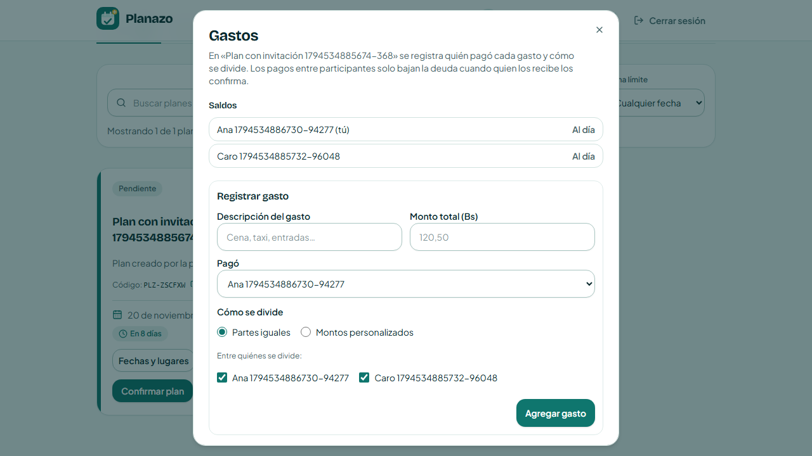
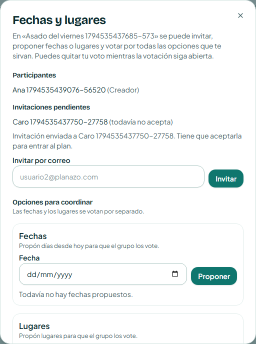
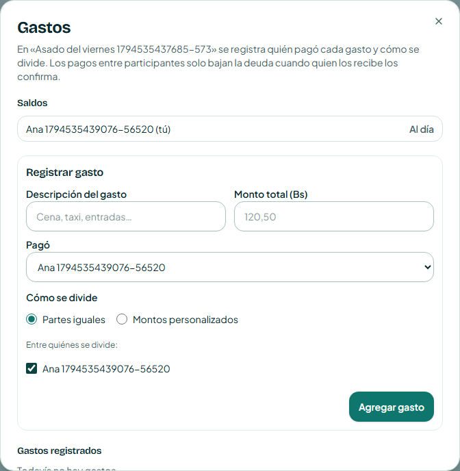
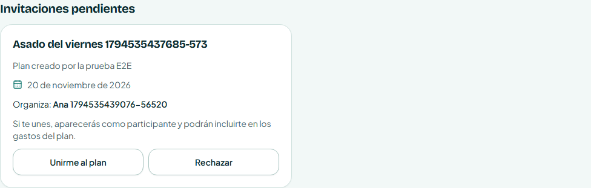

# Clase 22 — Patrones oscuros

## Integrantes

- Diego Joaquín Saavedra Alberto

Modalidad: con IA.

## 1. Patrón encontrado

**Tipo:** uso de datos o acciones sin consentimiento (cuesta más salir que entrar).

**Pantalla:** «Fechas y lugares» → «Invitar por correo».

Quien organiza un plan escribía el correo de otra persona y esa persona quedaba **adentro del plan al instante**, sin que nadie le preguntara. En el código viejo, `inviteByEmail` (`apps/backend/src/services/coordination.service.ts:93`) creaba directamente el `PlanMember` en la línea 111.

Eso tenía consecuencias encadenadas:

1. En «Gastos», «Partes iguales» marca por defecto a todos los participantes, así que la persona invitada quedaba incluida en el reparto y con deuda.
2. Con deuda, el sistema le bloquea «Abandonar plan» (`deuda_pendiente`). Entrar costaba cero clics y salir exigía pagar.

**A quién beneficia:** a quien organiza, que reparte el gasto entre más gente sin pedir permiso. Quien pierde es la persona invitada, que no eligió estar ahí.

## 2. Antes

Ana invita a Caro y abre «Gastos». Caro aparece en «Saldos» y marcada en «Entre quiénes se divide», sin haber aceptado nada.



```ts
// coordination.service.ts (antes), línea 111
await prisma.planMember.create({
  data: { planId, userId: person.id, role: "GUEST" },
});
```

## 3. Después

Invitar ahora crea una **invitación pendiente** (`PlanInvitation`). La persona no es participante hasta que acepta.

Quien organiza ve que la invitación está pendiente y el aviso «Tiene que aceptarla para entrar al plan»:



Mientras tanto, Caro no aparece en «Gastos»:



Caro ve la invitación en «Mis planes»: qué plan es, quién lo organiza, la fecha y qué implica unirse («podrán incluirte en los gastos del plan»). Decide con dos botones **iguales** y de un solo clic, «Unirme al plan» y «Rechazar». Ninguno está destacado ni escondido.



```ts
// coordination.service.ts (después), línea 119
await prisma.planInvitation.create({
  data: { planId, userId: person.id, invitedById: userId },
});
```

Archivos principales:

- Backend: modelo `PlanInvitation` y su migración, `services/invitations.service.ts` (listar, aceptar, rechazar) y `routes/invitations.ts` (`/api/invitations`). Si la persona se une con el código del plan, la invitación pendiente se borra.
- Frontend: `components/domain/PendingInvitations.tsx`, `hooks/useInvitations.ts`, y la lista «Invitaciones pendientes» en `PlanCoordinationDialog`.

### Commit

SHA: 7efa4fe649f331ff6f2fcdbb34ba7244b5bab50e

[fix(etica): pedir consentimiento antes de sumar a alguien a un plan · DSaav22/Proyecto-2-IHC-Cambiaso@7efa4fe](https://github.com/DSaav22/Proyecto-2-IHC-Cambiaso/commit/7efa4fe649f331ff6f2fcdbb34ba7244b5bab50e)

## 4. Principio aplicado

- **Consentimiento informado:** antes de entrar, la persona sabe qué plan es, quién lo organiza y que la pueden incluir en los gastos.
- **Control y libertad del usuario (Nielsen #3):** decide ella, y decir que no cuesta lo mismo que decir que sí (un clic, botón del mismo tamaño y estilo). Es la prueba de simetría de la clase: entrar y salir cuestan igual.
- **Privacidad por defecto:** mientras no acepta, su nombre no aparece en el reparto ni en la lista de participantes. Solo quien organiza ve que está pendiente.

## 5. Prueba

Test E2E: `tests/invitation-consent.spec.ts` (Playwright, 2 casos):

1. Ana invita a Caro, Caro **no** aparece en «Gastos», ve la invitación con dos botones iguales, acepta y recién entonces aparece en el reparto.
2. Caro rechaza: no entra al plan y quien organiza ya no la ve.

**Antes (código viejo):** falla en el paso «Caro todavía no aparece en el reparto de los gastos».

```text
Error: expect(locator).toHaveCount(expected) failed
Locator: getByRole('dialog', { name: 'Gastos' }).getByRole('checkbox', { name: 'Caro …' })
Expected: 0
Received: 1
```

**Después:** pasa, junto con toda la suite E2E.

```text
28 passed (2.0m)
```

También se actualizaron las E2E que invitaban a alguien (`expenses`, `leave-plan`, `multiple-votes`) para que la persona acepte antes de participar.

Tests unitarios (Vitest):

- Backend: `coordination.service.test.ts` (invitar crea una invitación y no un participante; 409 si ya está o ya tiene invitación; 403 si no organiza; el organizador ve las pendientes), `invitations.service.test.ts` (5 tests) y `plans.service.test.ts` (unirse con código borra la invitación). **243 tests pasan.**
- Frontend: `PendingInvitations.test.tsx` (5 tests) y un caso nuevo en `PlanCoordinationDialog.test.tsx`. **255 tests pasan.**

## 6. Otros que encontramos

- **El correo revela si alguien tiene cuenta.** Al invitar, «No hay una cuenta con ese correo.» le dice a cualquier organizador si un correo está registrado en Planazo (`coordination.service.ts:108`). Expone datos de terceros. No lo corregimos ahora.
- **«Cancelar» ambiguo en las confirmaciones.** `ConfirmDialog` usa «Cancelar» por defecto como botón de salida. En diálogos como «¿Abandonar este plan?» puede leerse como «cancelar el plan» en vez de «no hacer nada». En «Cancelar plan» ya se usa «Mantener plan», que es lo correcto; falta aplicarlo al resto.
