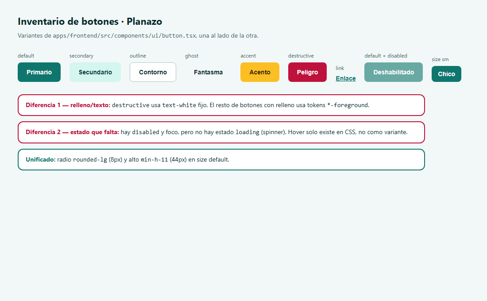

# Clase 23 · Inventario y tokens

Integrantes: Diego Joaquín Saavedra Alberto · Modalidad: sin IA

---

## 1. Inventario

Captura de los botones distintos de Planazo (`apps/frontend/src/components/ui/button.tsx`), uno al lado del otro:

### Diferencias encontradas

1. **Tono / relleno del texto:** la variante `destructive` usaba `text-white` escrito a mano. Las demás variantes con relleno usan tokens (`primary-foreground`, `secondary-foreground`, `accent-foreground`).
2. **Estado que faltaba:** existía `disabled` (opacidad) y foco (`focus-visible:ring-ring`), pero no había estado `loading` / pending.

Unificado: radio `rounded-lg` (8px) y alto táctil `min-h-11` (44px) en el size default.

Después del inventario (ya fuera del corte de clase): `destructive` pasó a `text-destructive-foreground` y el Button acepta `pending` / `aria-busy`.

---

## 2. Tokens

Tabla con cinco tokens nombrados **por uso**, no por apariencia. Valores claros de `apps/frontend/src/tokens.css`. Valores oscuros: propuesta (aún no hay tema oscuro en código). Todavía no se tocó el código para esto.

| Token | Claro | Oscuro | Dónde se usa |
| --- | --- | --- | --- |
| `primary` | `#0f766e` | `#2dd4bf` | Botón principal, links activos, logo |
| `destructive` | `#be123c` | `#fb7185` | Eliminar, abandonar, acciones irreversibles |
| `background` | `#f2f8f7` | `#062b30` | Fondo de Login, Mis planes, Mis datos |
| `foreground` | `#0b2a2e` | `#e6faf6` | Títulos y texto principal |
| `border` | `#d0e2df` | `#1f4a4f` | Bordes de cards, inputs y diálogos |

Mismos nombres en código (`bg-primary`, `var(--primary)`) y en Figma (`Planazo/Color` → `primary`).

---

## 3. Colores fijos

**Pantalla revisada:** Login (`/login`).

**Archivos buscados:**

- `apps/frontend/src/pages/LoginPage.tsx`
- `apps/frontend/src/components/domain/AuthDialog.tsx`
- `apps/frontend/src/components/domain/Field.tsx`
- `apps/frontend/src/components/domain/Notices.tsx`
- `apps/frontend/src/components/domain/TextLink.tsx`
- `apps/frontend/src/components/ui/button.tsx` (usado por Login)

**Qué busqué** (Ctrl+Shift+F / ripgrep):

- `#` + hex (`#6d4aff`, `#0f766e`, …)
- `rgb(…)`, `rgba(…)`, `hsl(…)`, `hsla(…)`
- `Color(0x…)`
- Tailwind arbitrario: `bg-[#…]`, `text-[#…]`

**Cuántos encontré:**

| Tipo | Cantidad en la pantalla Login |
| --- | ---: |
| Hex / `rgb` / `hsl` / `Color(0x…)` / `bg-[#…]` | **0** |
| Clase de color fija (`text-white` en `button.tsx` → `destructive`) | **1** |

Los **20** hex del producto están solo en `tokens.css` (definiciones del sistema), no sueltos en la pantalla.

Hoy solo se cuenta; no se corrige.
