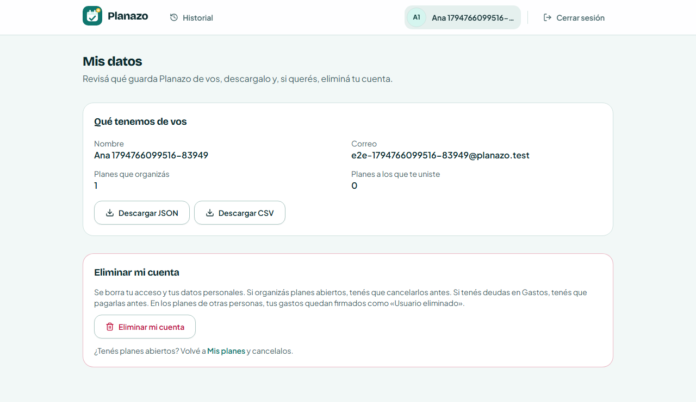
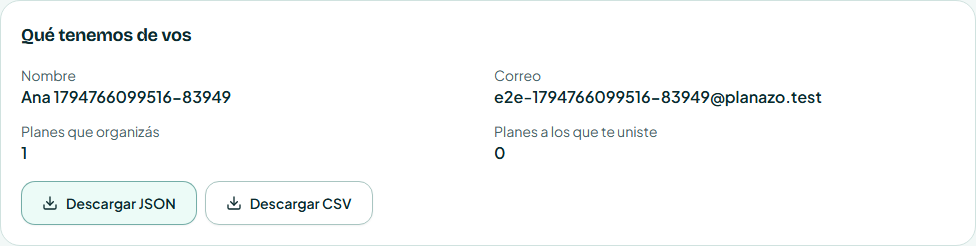
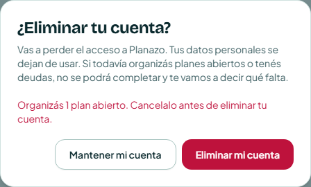
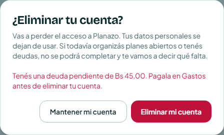
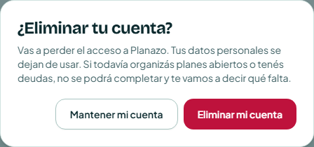
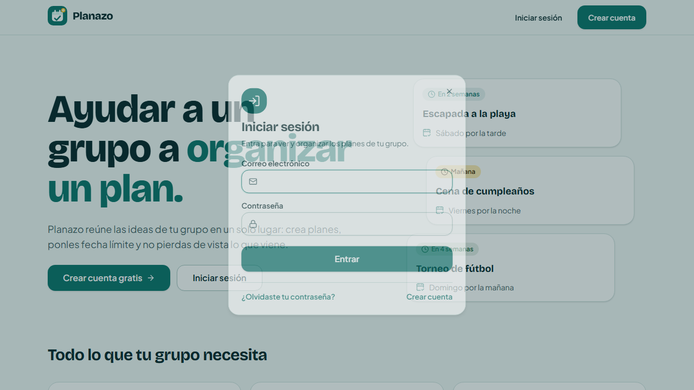
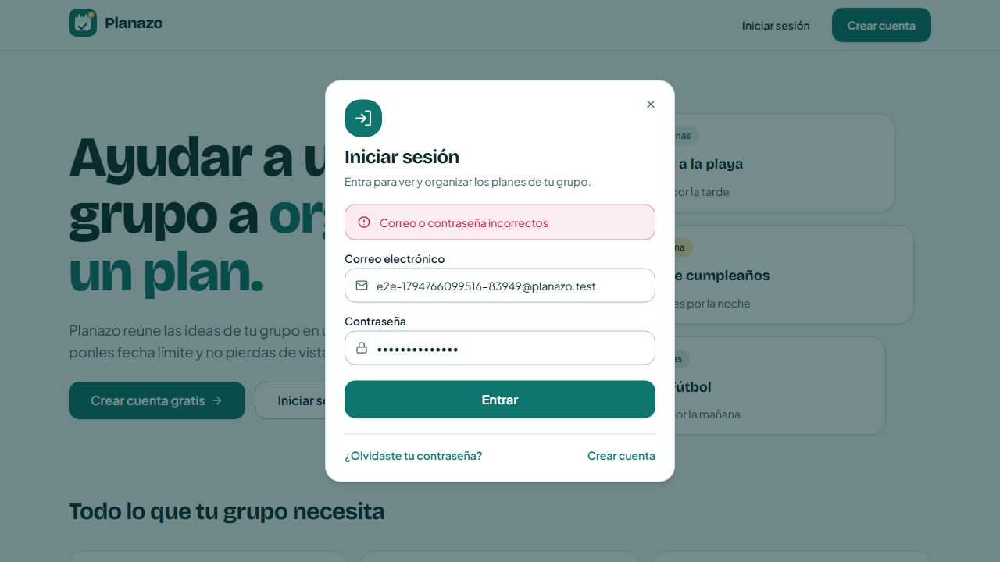

# Tarea 10 — Mis datos y salida honesta

## Integrantes

- Diego Joaquín Saavedra Alberto

Modalidad: sin IA

## Qué se entregó

Flujo completo en `/mis-datos`:

1. Ver los datos de la cuenta.
2. Descargarlos en JSON o CSV.
3. Eliminar la cuenta con la regla de Planazo y una confirmación honesta.
4. Revisión de los seis patrones en toda la app.
5. E2E, eventos y estas capturas.

## Cómo usarlo

Desde la barra superior, el perfil lleva a **Mis datos**. Ahí se ve el resumen, los botones de descarga y la salida.



### Descarga

«Descargar JSON» y «Descargar CSV» tienen el mismo estilo. El archivo incluye nombre, correo, planes propios, planes unidos, invitaciones y actividad.



### Regla de Planazo al eliminar

- Si organizás planes abiertos (`pendiente` o `confirmado`), hay que cancelarlos antes.
- Si tenés deudas en Gastos, hay que pagarlas antes.
- Si la regla bloquea, el mensaje dice **por qué** y **qué hacer**.
- Si se puede eliminar: se anonimiza la cuenta (`Usuario eliminado`), se cierran membresías e invitaciones, y esa cuenta ya no puede entrar.

Bloqueo por planes abiertos:



Bloqueo por deuda:



### Confirmación honesta

Botones del mismo tamaño (`min-h-11`), consecuencias claras, sin culpa. «Mantener mi cuenta» frente a «Eliminar mi cuenta» (no un enlace gris escondido).



Después de eliminarla, vuelve al login:



Con el mismo correo y contraseña ya no entra:



## Archivos principales

- Backend: `lib/accountDeletion.ts` (la regla), `services/account.service.ts` (exportar / borrar), `routes/account.ts`.
- Frontend: `pages/MyDataPage.tsx` (toda la pantalla) y el enlace del perfil en `ProfileMenu`.
- Eventos: `datos_descargados`, `eliminacion_iniciada`, `cuenta_eliminada`, `eliminacion_bloqueada`. Sin datos personales.

## Prueba

E2E: `tests/account-exit.spec.ts`

```text
2 passed
```

Unitarias:

```text
backend  253 passed
frontend 260 passed
```

## Revisión de los seis patrones

| Patrón | ¿Dónde en Planazo? | Estado |
| --- | --- | --- |
| 1. Opciones preseleccionadas | No hay casillas de marketing o ubicación marcadas al unirse. En Gastos, «Partes iguales» marca a los participantes actuales: es el modo del gasto, no un opt-in oculto. | Sin hallazgo grave |
| 2. Confirmaciones engañosas | «Cancelar» genérico en varios `ConfirmDialog` puede confundirse con cancelar el plan. En eliminar cuenta usamos «Mantener mi cuenta». | Corregido en salida de cuenta; pendiente en otros diálogos |
| 3. Urgencia, culpa o escasez falsas | No hay contadores inventados ni textos de culpa al salir. | No encontrado |
| 4. Datos expuestos sin necesidad | Al invitar, «No hay una cuenta con ese correo» revela si un correo está registrado (`coordination.service.ts`). | Pendiente |
| 5. Salir más difícil que entrar | Antes, invitar metía a la persona al plan sin aceptar (Clase 22, corregido). No había forma de ver/descargar datos ni borrar la cuenta. | Corregido (invitación + Mis datos / eliminar cuenta) |
| 6. Permisos sin explicar | App web: no pide ubicación ni sensores al abrir. | No aplica |

