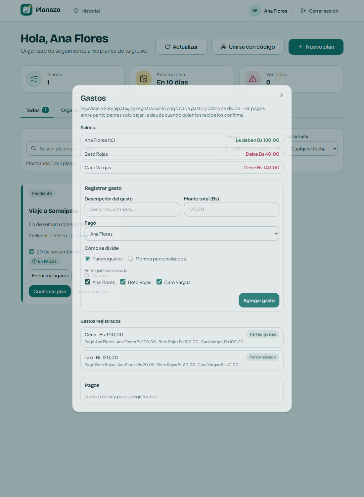
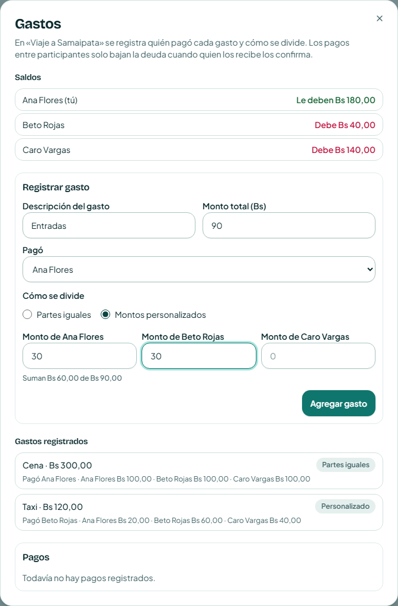
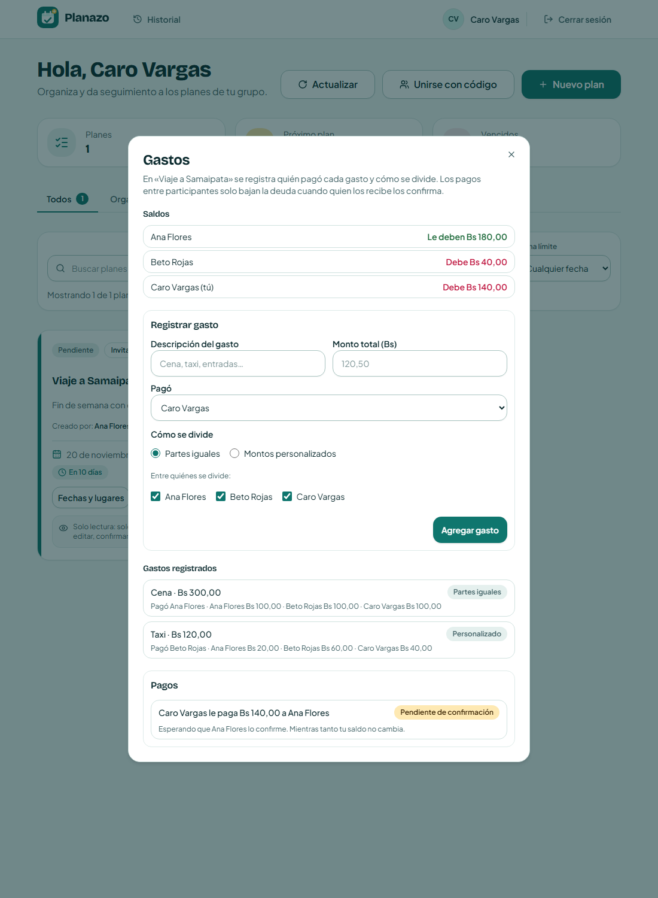
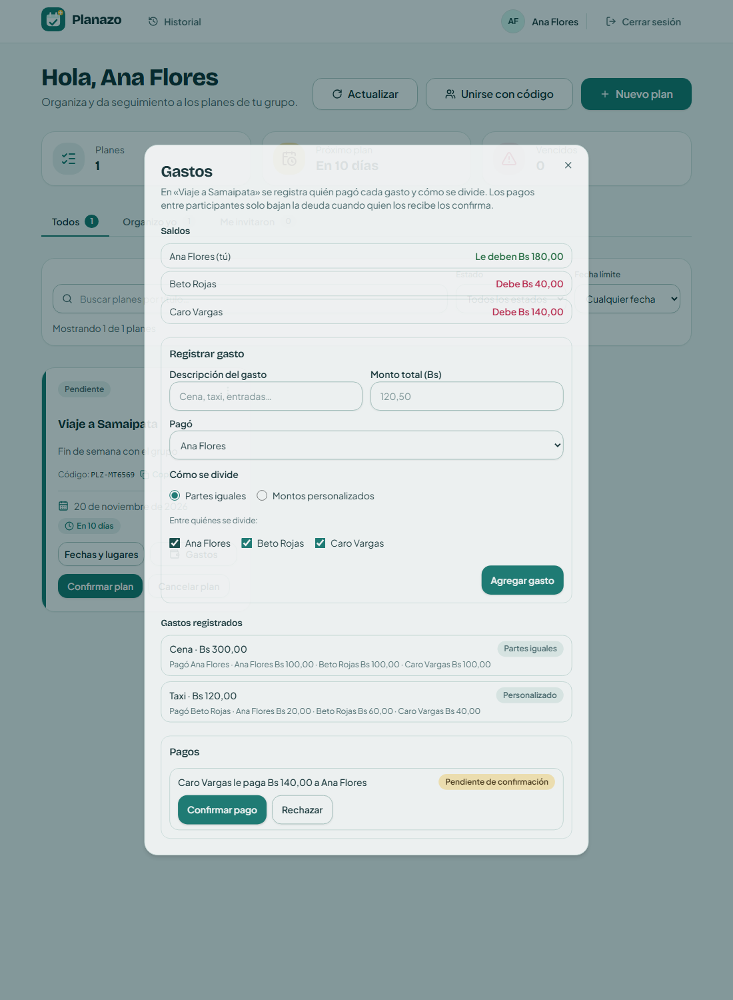
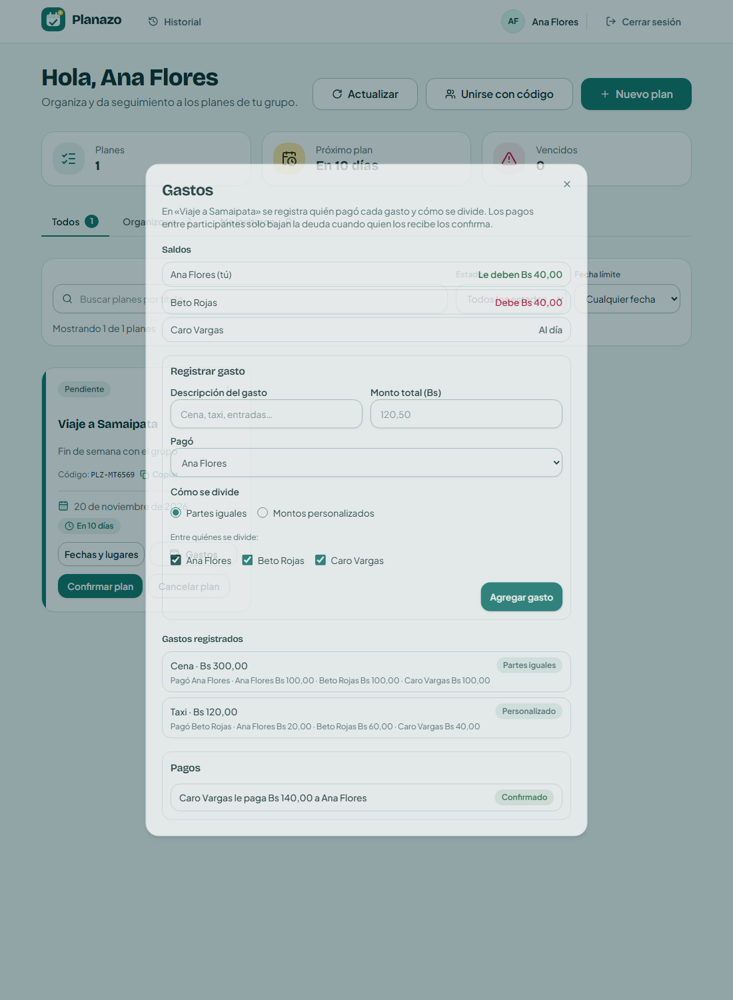

# Tarea 8 — Gastos y liquidación

## Integrantes

- Diego Joaquín Saavedra Alberto

## Funcionalidad

Cada plan ahora tiene un botón **Gastos** en su tarjeta. Ahí el grupo:

1. Registra un gasto: qué fue, cuánto costó y quién lo pagó.
2. Lo divide entre los participantes que elija, **en partes iguales** o con **montos personalizados**. Si los montos personalizados no suman el total, no se guarda.
3. Ve los **saldos**: a quién le deben y quién debe, en bolivianos.
4. Quien debe **registra un pago**. El pago queda *pendiente de confirmación* y no cambia ningún saldo.
5. Quien recibe el pago lo **confirma** o lo **rechaza con un motivo**. Solo la confirmación baja la deuda, y un pago no se puede confirmar dos veces.

Participantes son quien creó el plan y las personas que se unieron o fueron invitadas, igual que en "Fechas y lugares".

## Demostración

Con tres participantes (Ana creó el plan e invitó a Beto y Caro):

| Paso | Ana | Beto | Caro |
| --- | --- | --- | --- |
| Ana paga la cena, Bs 300, partes iguales | Le deben 200 | Debe 100 | Debe 100 |
| Beto paga el taxi, Bs 120, personalizado (Ana 20, Beto 60, Caro 40) | Le deben 180 | Debe 40 | Debe 140 |
| Caro registra un pago de Bs 140 a Ana (pendiente) | Le deben 180 | Debe 40 | Debe 140 |
| Ana confirma el pago | Le deben 40 | Debe 40 | Al día |

Los saldos solo se mueven en la última fila. Mientras el pago está pendiente, nada cambia.

Saldos y gastos después de los dos gastos:



La división personalizada muestra en vivo cuánto suman los montos frente al total:



Caro registró el pago. Queda pendiente y su saldo sigue en Bs 140:



Ana ve el pago con los botones Confirmar y Rechazar. Caro no los ve:



Después de confirmar y recargar la página: Ana queda en Bs 40 a favor y Caro al día:



## Decisiones

- **Montos en centavos.** En la base se guardan enteros (Bs 120,50 → 12050). Así una división no deja decimales sueltos y los saldos de todo el grupo siempre suman cero.
- **El centavo que sobra.** Si Bs 100 se divide entre 3, quedan 33,34 + 33,33 + 33,33. El centavo extra va a las primeras personas de la lista, siempre en el mismo orden.
- **El saldo se calcula, no se guarda.** Saldo = lo que pagó − lo que le toca + pagos confirmados que hizo − pagos confirmados que recibió. Se recalcula con cada consulta, así no puede quedar desactualizado.
- **No aplicar un pago dos veces.** La confirmación actualiza el pago *solo si sigue pendiente*, en una sola operación de la base (`updateMany` con `status: "pendiente"`). Si llegan dos confirmaciones, la segunda no cambia nada y responde 409.
- **Restricciones de los pagos:**
  - Solo quien recibe el pago puede confirmarlo o rechazarlo (403 para cualquier otra persona).
  - Un solo pago pendiente por pareja (409 si ya hay otro).
  - No se puede pagar más de lo que se debe, descontando los pagos que ya están pendientes.
  - No se puede pagar a alguien que no tiene saldo a favor.
  - Rechazar exige un motivo.
- **Plan cancelado.** No admite gastos nuevos, pero los pagos sí se pueden seguir registrando para saldar lo que ya se debe.
- **Mismas palabras en todos lados.** "Le deben / Debe / Al día" se usan en la lista de saldos y en el aviso del pago. Cada pago dice "Pendiente de confirmación", "Confirmado" o "Rechazado".

## Archivos afectados

**Base de datos**

- `apps/backend/prisma/schema.prisma`: modelos `PlanExpense`, `PlanExpenseShare` (cuánto le toca a cada persona) y `PlanPayment`.
- `apps/backend/prisma/migrations/20261110150000_add_expenses_and_payments/migration.sql`.

**Backend**

- `apps/backend/src/lib/expenses.ts`: validación de montos con zod, división en partes iguales, validación de la división personalizada y cálculo de saldos. No toca la base.
- `apps/backend/src/services/expenses.service.ts`: reglas que necesitan la base (participantes, plan cancelado, pago duplicado, pagar de más, confirmar una sola vez).
- `apps/backend/src/routes/expenses.ts`: rutas HTTP. Se registran dentro del router de planes (`routes/plans.ts`):
  - `GET /api/plans/:id/expenses`
  - `POST /api/plans/:id/expenses`
  - `POST /api/plans/:id/payments`
  - `POST /api/plans/:id/payments/:paymentId/confirm`
  - `POST /api/plans/:id/payments/:paymentId/reject`

**Frontend**

- `apps/frontend/src/api/client.ts`: tipos y llamadas a la API.
- `apps/frontend/src/hooks/usePlanExpenses.ts`: carga del tablero y acciones.
- `apps/frontend/src/lib/money.ts`: formato `Bs 120,50` y textos de saldo.
- `apps/frontend/src/components/domain/PlanExpensesDialog.tsx`: el diálogo (Saldos, Registrar gasto, Gastos registrados, Pagos).
- `apps/frontend/src/components/domain/PlanCard.tsx`: botón "Gastos".

**Pruebas**

- `apps/backend/src/lib/expenses.test.ts` (13 tests) y `apps/backend/src/services/expenses.service.test.ts` (12 tests).
- `apps/frontend/src/lib/money.test.ts` (6 tests).
- `tests/expenses.spec.ts`: las dos E2E.

## Pruebas E2E

`tests/expenses.spec.ts` tiene dos pruebas. Cada una crea sus propios usuarios con correos únicos, así se pueden repetir sin limpiar la base y no dependen de los usuarios de la semilla.

1. **Recorrido completo.** Tres participantes en tres navegadores, dos gastos (uno en partes iguales y otro personalizado), y un pago de Caro que queda pendiente sin cambiar saldos. Ana lo confirma y se actualizan los dos saldos. Al final recarga la página y comprueba que gastos, pago y saldos siguen guardados.
2. **Restricciones:**
   - Una división personalizada que no suma el total se rechaza y no se guarda.
   - Beto no puede dejar dos pagos pendientes a Ana.
   - Beto no puede confirmar su propio pago (403, llamando a la API con su sesión).
   - Ana confirma una vez; una segunda confirmación responde 409 y, después de recargar, la deuda bajó una sola vez.
   - Un pago rechazado con motivo muestra el motivo y no baja la deuda.

## Cómo correr las pruebas

Con la app levantada (`pnpm dev`, o backend y frontend por separado como en la Tarea 6) y las migraciones aplicadas:

```bash
corepack pnpm --filter backend exec prisma migrate deploy
corepack pnpm --filter backend exec vitest run
corepack pnpm --filter frontend exec vitest run
corepack pnpm test:e2e
corepack pnpm test:e2e tests/expenses.spec.ts
```

En mi máquina había otro proyecto con Vite escuchando en `[::1]:5173`, y `localhost` caía en esa app. Por eso corrí las E2E con `E2E_BASE_URL=http://127.0.0.1:5173`.

## Resultados

**E2E de esta tarea:** 2 de 2 pasan.

**Suite E2E completa:** 21 pasan y 3 fallan. Los 3 fallos **no vienen de esta tarea** y ya fallaban antes:

| Prueba | Por qué falla |
| --- | --- |
| `multiple-votes.spec.ts` › Se vota por varias opciones… | Busca el título "Propuestas" y el botón "Cerrar votación" del diálogo de Fechas y lugares. En la Tarea 7 el título pasó a "Opciones para coordinar" y cerrar la votación se cambió por "Cerrar votación y confirmar plan". La prueba no se actualizó. |
| `multiple-votes.spec.ts` › Solo quien creó el plan ve el botón… | Mismo motivo. |
| `accessibility.spec.ts` › El diálogo de Fechas y lugares… | Espera el mismo título "Propuestas" antes de revisar accesibilidad. |

**Tests unitarios:**

- Frontend: 238 de 238 pasan (20 archivos).
- Backend: 219 de 220 pasan. Falla `coordination.test.ts` › "acepta una fecha", que usa la fecha fija `2026-11-08`. Desde la Tarea 7 no se aceptan fechas pasadas, así que el test falla desde el 9 de noviembre. No tiene que ver con gastos.
- Los 25 tests nuevos de gastos del backend y los 6 del frontend pasan.

Queda pendiente actualizar esas pruebas de la votación al flujo nuevo de la Tarea 7 y cambiar la fecha fija por una relativa a hoy.


