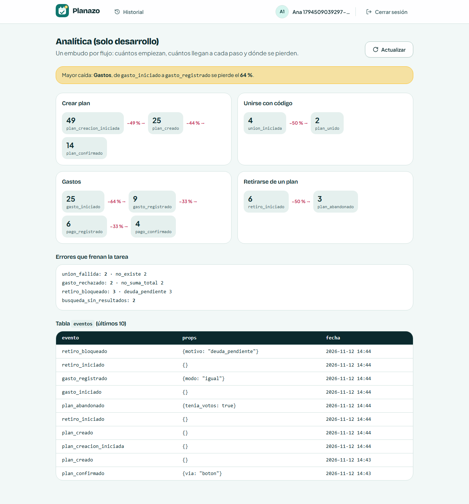
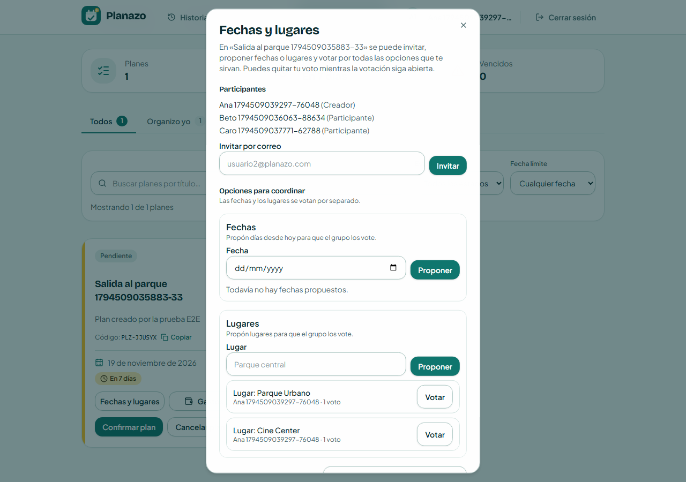
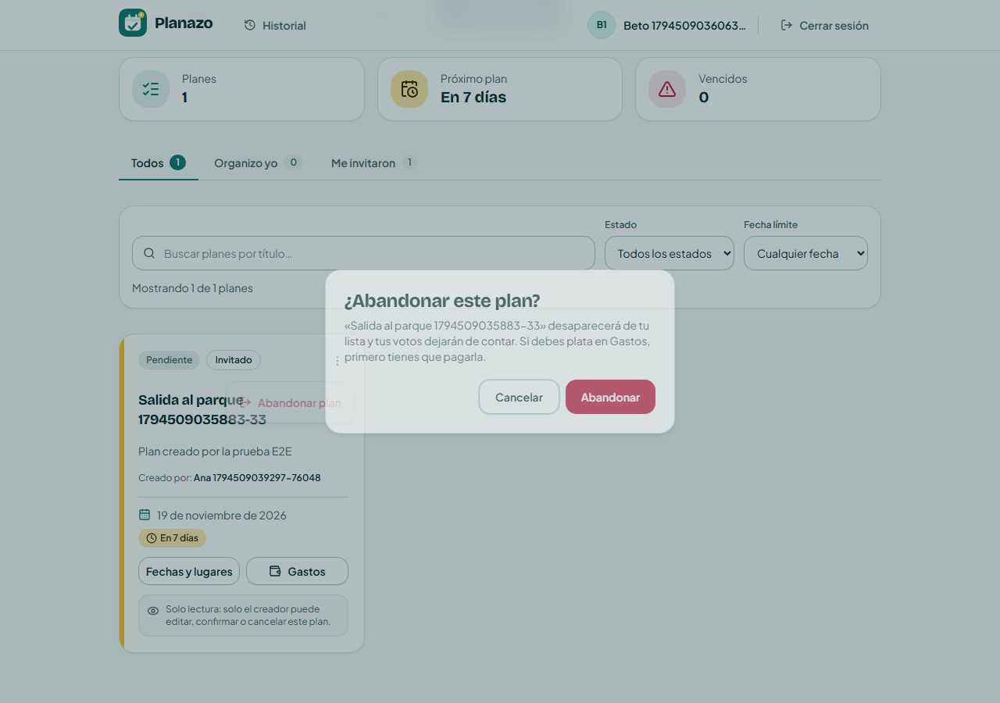
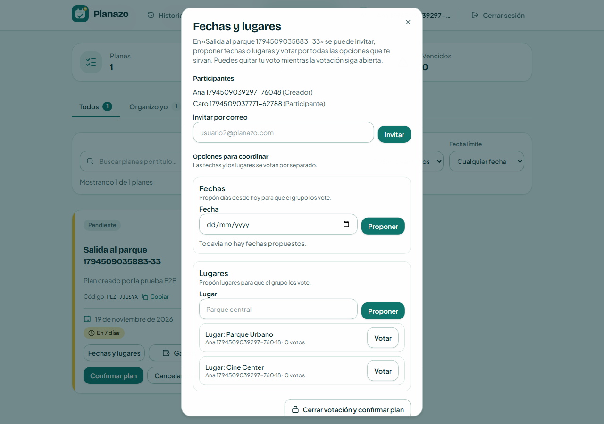
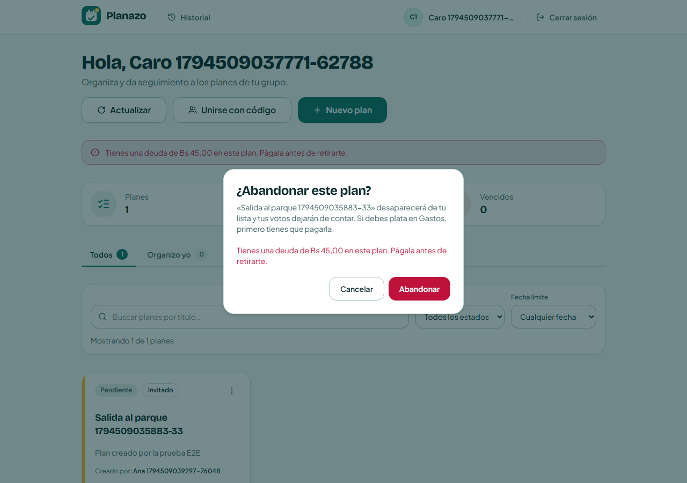

# Tarea 9 — Analítica en todo el producto y "Retirarse de un plan"

## Integrantes

- Diego Joaquín Saavedra Alberto

Modalidad: con IA.

---

## Parte A — Analítica en todo el producto

En la Clase 21 solo medía crear y confirmar un plan. Ahora cada flujo principal tiene su embudo, desde el clic que lo empieza hasta el éxito.

### Mapa de la app con los eventos

Antes de programar marqué en qué pantalla va cada evento:

```text
Mis planes
├── [Nuevo plan] ............ plan_creacion_iniciada
│   └── Crear plan .......... plan_creado
│       └── Confirmar ....... plan_confirmado (via: boton | votacion)
├── [Unirse con código] ..... union_iniciada
│   └── Unirse al plan ...... plan_unido  |  union_fallida (motivo)
├── Filtros / búsqueda ...... busqueda_sin_resultados (filtro)
└── Tarjeta del plan
    ├── [Gastos] ............ gasto_iniciado
    │   ├── Agregar gasto ... gasto_registrado (modo)  |  gasto_rechazado (motivo)
    │   ├── Registrar pago .. pago_registrado
    │   └── Confirmar pago .. pago_confirmado
    └── ⋮ > Abandonar plan .. retiro_iniciado
        └── Abandonar ....... plan_abandonado (tenia_votos)  |  retiro_bloqueado (motivo)
```

### Eventos

| Evento | Flujo | Dónde (`archivo:línea`) | Pregunta que responde |
| --- | --- | --- | --- |
| `plan_creacion_iniciada` | Crear plan | `apps/frontend/src/pages/MyPlansPage.tsx:153` | ¿Cuántos empiezan a crear un plan? |
| `plan_creado` | Crear plan | `apps/frontend/src/hooks/usePlans.ts:116` | ¿Cuántos terminan el formulario? |
| `plan_confirmado` | Crear plan | `apps/frontend/src/hooks/usePlans.ts:164` y `apps/frontend/src/hooks/usePlanCoordination.ts:60` | ¿Cuántos planes llegan a concretarse, y por qué vía? |
| `union_iniciada` | Unirse con código | `apps/frontend/src/pages/MyPlansPage.tsx:229` | ¿Cuántos intentan unirse? |
| `plan_unido` | Unirse con código | `apps/frontend/src/hooks/usePlans.ts:131` | ¿Cuántos lo logran? |
| `union_fallida` | Unirse con código | `apps/frontend/src/hooks/usePlans.ts:137` | ¿Por qué falla: código que no existe, ya estaba unido o código no válido? |
| `gasto_iniciado` | Gastos | `apps/frontend/src/components/domain/PlanCard.tsx:253` | ¿Cuántos abren Gastos? |
| `gasto_registrado` | Gastos | `apps/frontend/src/hooks/usePlanExpenses.ts:57` | ¿Cuántos registran un gasto? ¿Usan partes iguales o montos personalizados? (feature de la Tarea 8) |
| `gasto_rechazado` | Gastos | `apps/frontend/src/hooks/usePlanExpenses.ts:55` | ¿Qué validación frena a la gente? |
| `pago_registrado` | Gastos | `apps/frontend/src/hooks/usePlanExpenses.ts:63` | ¿Quien debe, paga? |
| `pago_confirmado` | Gastos | `apps/frontend/src/hooks/usePlanExpenses.ts:69` | ¿Los pagos se cierran o quedan pendientes? |
| `retiro_iniciado` | Retirarse | `apps/frontend/src/components/domain/PlanCard.tsx:177` | ¿Cuántos quieren salir de un plan? (feature de la Tarea 9) |
| `plan_abandonado` | Retirarse | `apps/frontend/src/hooks/usePlans.ts:211` | ¿Cuántos salen, y salen con votos que cambian el conteo? |
| `retiro_bloqueado` | Retirarse | `apps/frontend/src/hooks/usePlans.ts:218` | ¿Cuántos quedan bloqueados, por deuda o porque el plan ya cerró? |
| `busqueda_sin_resultados` | Buscar y filtrar | `apps/frontend/src/pages/MyPlansPage.tsx:116` | ¿Qué filtro deja a la gente sin resultados? |

Reglas que seguí:

- Los eventos de éxito van después del `await` que habla con el servidor. Si la acción falla, no se guardan.
- Los eventos de inicio van en el clic y no en un `useEffect`, porque en desarrollo React ejecuta los efectos dos veces y contaría doble.
- La búsqueda sin resultados se guarda una sola vez por búsqueda, cuando la persona dejó de escribir un segundo y la lista ya llegó. Si no, contaría cada letra.
- Los motivos de error son de una lista fija. El backend (`apps/backend/src/lib/analytics.ts`) rechaza con 400 cualquier motivo, evento o prop que no esté en la lista.

### Qué no guardo y por qué

- **Cada clic o pantalla abierta:** "Fechas y lugares", "Historial" o "Actualizar" no responden ninguna de mis preguntas.
- **Datos personales:** ni nombre, ni correo, ni id del usuario o del plan. Las preguntas cuentan acciones, no personas.
- **Texto escrito por el usuario:** ni el título, ni la descripción del gasto, ni el código que escribió, ni lo que buscó, ni el motivo de rechazo de un pago. En `busqueda_sin_resultados` guardo solo qué tipo de filtro usó (`texto`, `estado`, `fecha` o `varios`).
- **Montos:** son datos del grupo y no ayudan a encontrar dónde se pierde la gente.
- **Rechazar un pago:** es una decisión de quien recibe, no un error que frene la tarea.

### Panel `/analitica`

Solo existe en desarrollo. Muestra un embudo por flujo con la caída entre pasos, la mayor caída arriba, los errores con su motivo y la tabla `eventos`.



Los números son de mis pruebas locales: las E2E y lo que probé a mano.

### Mayor caída y qué cambiaría

La mayor caída está en **Gastos**: de `gasto_iniciado` a `gasto_registrado` se pierde el **64 %**. De 25 veces que se abrió Gastos, solo 9 terminaron en un gasto registrado.

Creo que pasa porque el botón "Gastos" sirve para dos cosas: ver los saldos y agregar un gasto. Mucha gente lo abre solo para ver cuánto debe, y eso cuenta como un inicio que nunca termina.

Qué cambiaría:

1. Mostrar el saldo de cada persona en la misma tarjeta del plan ("Debes Bs 45"), para que no haga falta abrir Gastos solo para mirarlo.
2. Medir el inicio en el botón "Agregar gasto" y no al abrir el diálogo. Así el embudo mide a quien de verdad quiere registrar un gasto.

La segunda caída más grande es en "Crear plan": de `plan_creacion_iniciada` a `plan_creado` se pierde el 49 %. Revisaría si el formulario pide demasiado al inicio.

---

## Parte B — Retirarse de un plan

### Reglas

- Un participante puede retirarse mientras el plan siga abierto. Sus votos se borran en la misma transacción que su participación, así que el conteo se recalcula solo.
- Quien organiza no puede retirarse (403). Para él la opción ni aparece; tiene "Cancelar" y "Eliminar".
- Si el plan ya se cerró (votación cerrada o plan confirmado), no se puede retirar (409, motivo `plan_cerrado`).
- Si debe plata en Gastos, no se puede retirar (409, motivo `deuda_pendiente`). El mensaje le dice cuánto debe.

Archivos principales:

- `apps/backend/src/lib/leavePlan.ts:6`: la regla (`leaveBlock`) en una función pura.
- `apps/backend/src/services/plans.service.ts:481`: consulta el saldo y aplica la regla.
- `apps/backend/src/services/plans.service.ts:485`: borra los votos y la participación en una transacción.
- `apps/backend/src/routes/plans.ts:284`: responde 409 con el mensaje y el motivo.

### Demostración

Ana creó el plan e invitó a Beto y Caro. Beto votó por los dos lugares:



Beto se retira:



Los dos lugares bajan a 0 votos y Beto ya no aparece en los participantes:



Ana registra unas entradas de Bs 90 en partes iguales, así que Caro debe Bs 45. Caro intenta retirarse y se le bloquea:



---

## Pruebas

Unitarias (Vitest):

- `apps/backend/src/lib/leavePlan.test.ts`: plan abierto sin deuda pasa; plan cerrado o con deuda se bloquea con el motivo correcto.
- `apps/backend/src/services/plans.service.test.ts`: el retiro borra votos y participación, y el organizador o alguien con deuda no puede salir.
- `apps/backend/src/lib/analytics.test.ts`: acepta los motivos de la lista y rechaza otros motivos, eventos desconocidos y datos personales.
- `apps/frontend/src/lib/funnels.test.ts`: caída entre pasos, sin dividir por cero, y cuál es la mayor caída.
- `apps/frontend/src/hooks/usePlans.test.tsx`: `union_fallida`, `plan_abandonado` con `tenia_votos` y `retiro_bloqueado` con el motivo del servidor.

E2E (Playwright). Cada flujo comprueba que mandó sus eventos:

- `tests/analytics.spec.ts`: crear y confirmar un plan (`plan_creacion_iniciada`, `plan_creado`, `plan_confirmado`), sin datos personales, y que `/analitica` muestra los cuatro embudos.
- `tests/join-plan.spec.ts`: unirse bien (`union_iniciada`, `plan_unido`) y con un código que no existe (`union_fallida` con `no_existe`).
- `tests/expenses.spec.ts`: `gasto_iniciado`, `gasto_registrado` (igual y personalizado), `pago_registrado`, `pago_confirmado` y `gasto_rechazado` con `no_suma_total`.
- `tests/plan-filters.spec.ts`: un filtro sin resultados manda `busqueda_sin_resultados` con `filtro: estado`.
- `tests/leave-plan.spec.ts` (la funcionalidad de la Parte B): Beto se retira con dos votos y el conteo baja a 0; Caro tiene deuda y queda bloqueada. También revisa `plan_abandonado` con `tenia_votos: true` y `retiro_bloqueado` con `deuda_pendiente`.

### Cómo correrlas

```bash
corepack pnpm --filter backend exec vitest run
corepack pnpm --filter frontend exec vitest run
corepack pnpm test:e2e
```

### Resultados

- Backend: 231 de 231.
- Frontend: 249 de 249.
- E2E: 26 de 26.

## Commits

- Parte B (funcionalidad): [`03dc9e7` feat: retirarse de un plan quitando votos y bloqueando con deudas](https://github.com/DSaav22/Proyecto-2-IHC-Cambiaso/commit/03dc9e76a315970fdc2308408983f1ffc84025a5)
- Parte A (analítica): [`93cf563` feat: registrar eventos y embudos de todos los flujos en /analitica](https://github.com/DSaav22/Proyecto-2-IHC-Cambiaso/commit/93cf563d78e08b6f8c4fd4a31488828d0bc7d2d5)
- Evidencia: [`c2f337b` docs: agregar evidencia de la Tarea 9](https://github.com/DSaav22/Proyecto-2-IHC-Cambiaso/commit/c2f337b7688d736fff5be06878f05eb2707caef5)
