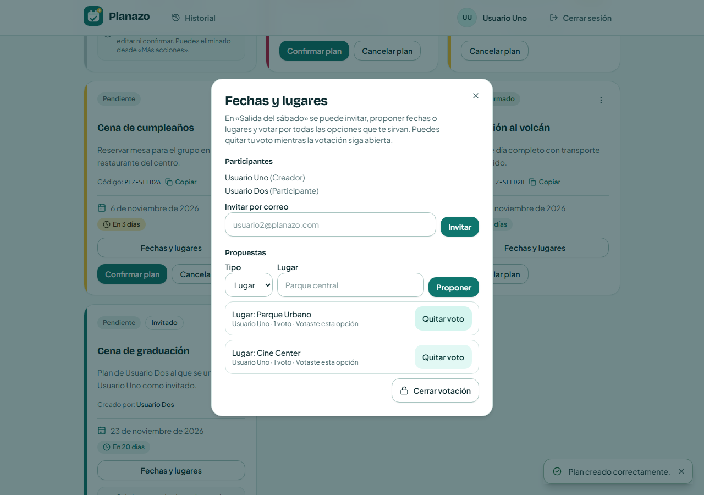
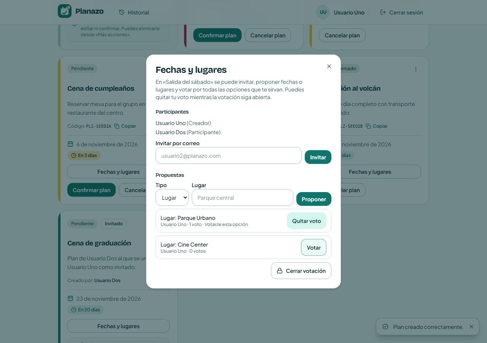
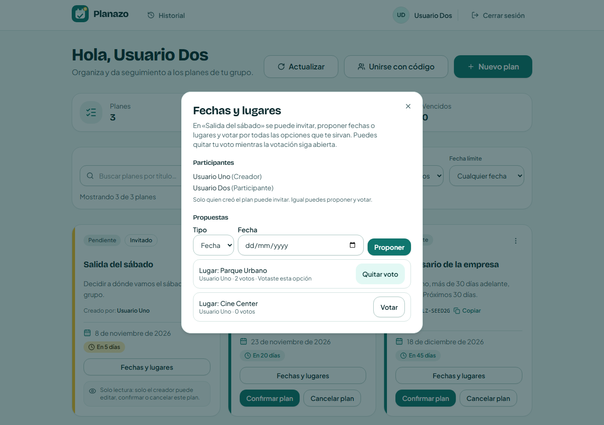
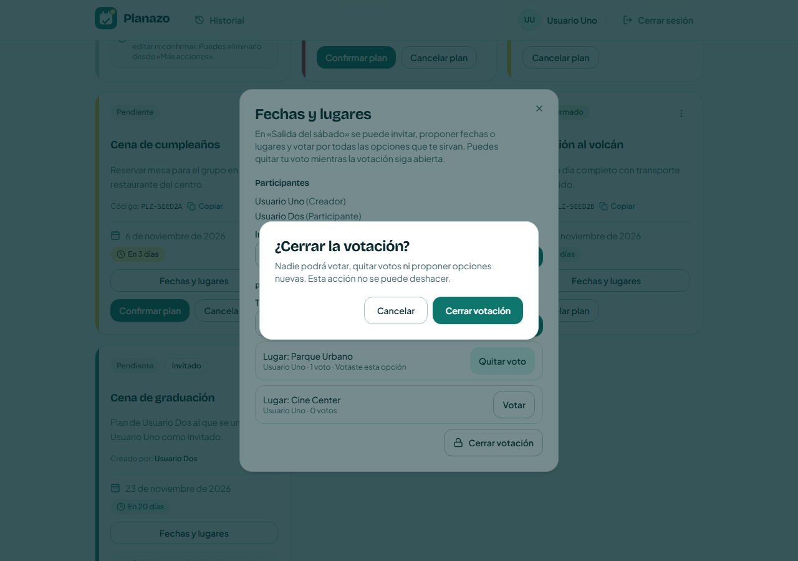
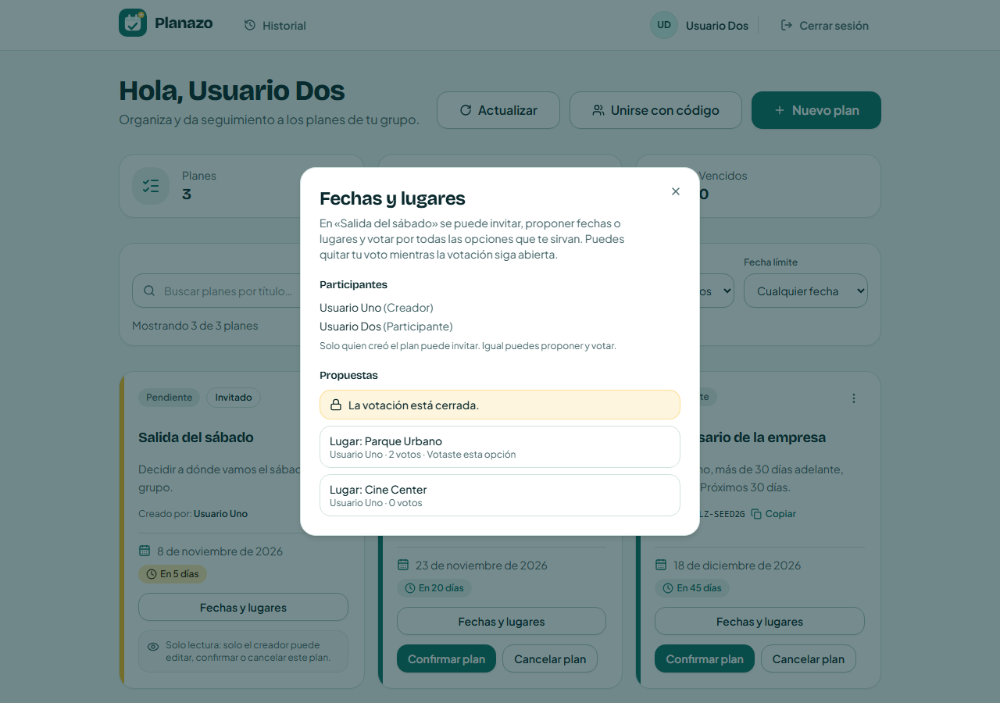

	# Tarea 6 — Pruebas E2E y varios votos

## Qué había que hacer

La tarea tiene dos partes. En la A hay que hacer pruebas E2E con Playwright para los flujos del app map, cada uno con su caso normal y al menos uno alternativo, más accesibilidad, regresión visual y que todo se pueda correr desde la semilla. En la B había que agregar una feature. A Planazo le tocó **Varios votos**: votar por más de una opción, poder sacar el voto antes de que cierre y que después de cerrar ya no se pueda votar.

Lo que dejó la Tarea 5 era un voto por persona en cada plan. Si votabas otra opción, el voto se movía. No había forma de sacarlo y la votación nunca terminaba.

## Parte B: cómo quedó la votación

### Base de datos

En `apps/backend/prisma/schema.prisma` cambié dos cosas. `Plan` tiene un campo nuevo, `votingClosedAt` (línea 33). Si está vacío la votación sigue abierta, y si tiene fecha está cerrada. En `PlanVote` (líneas 88-100) antes la regla era `@@unique([planId, userId])`, o sea una persona un voto por plan. Ahora es `@@unique([optionId, userId])`: una persona puede votar varias opciones, pero cada opción una sola vez.

La migración es `apps/backend/prisma/migrations/20261103190000_allow_multiple_votes/migration.sql`. Saca el índice viejo, crea el nuevo y agrega la columna. Los votos que ya existían cumplen la regla nueva (nadie tenía dos votos en el mismo plan), así que no hubo que tocar datos.

### Backend

La regla está en `apps/backend/src/services/coordination.service.ts`:

- `requireOpenVote` (líneas 37-39) corta con 409 "La votación está cerrada." Lo usan `addOption` (98), `castVote` (123) y `removeVote` (136), así que cerrada no se puede proponer, votar ni sacar votos.
- `castVote` (123-134) hace un `upsert` sobre opción y persona. Si votás dos veces la misma opción no suma, y tampoco toca tus votos en las otras.
- `removeVote` (136-143) borra solo tu voto de esa opción.
- `closeVoting` (145-157) pone la fecha en `votingClosedAt`. Si no sos el creador da 403 "Solo quien creó el plan puede cerrar la votación.", y si ya estaba cerrada da 409.
- `getCoordination` ahora devuelve `votingClosed` y marca `mine` en cada opción que votaste, no en una sola.

Las rutas están en `apps/backend/src/routes/plans.ts`. `POST /:id/votes` (368-385) ya existía y ahora suma un voto en vez de moverlo. Son nuevas `DELETE /:id/votes/:optionId` (387-406) y `POST /:id/voting/close` (408-424). Todas devuelven el tablero completo, igual que las de la Tarea 5.

### Frontend

En `apps/frontend/src/api/client.ts` están `removePlanVote` y `closePlanVoting` (líneas 154-156), y en `apps/frontend/src/hooks/usePlanCoordination.ts` las acciones `unvote` y `closeVoting` (51-52).

El diálogo es `apps/frontend/src/components/domain/PlanCoordinationDialog.tsx`. Cada opción tiene un botón que cambia entre "Votar" y "Quitar voto" (186-201). Para el lector de pantalla el botón dice de qué opción es ("Votar por Lugar: Parque Urbano") y tiene `aria-pressed`. El creador ve "Cerrar votación" abajo de las propuestas (208-226), que abre el mismo `ConfirmDialog` que se usa para cancelar planes. Cuando está cerrada aparece "La votación está cerrada." (127) y desaparecen el formulario para proponer y los botones de votar, pero los conteos se siguen viendo.

## Cómo lo corrí

Igual que en la Clase 17, sin Docker y con PostgreSQL 17 en el puerto 5432. Esta vez el 5173 estaba ocupado por otro proyecto, así que Vite levantó Planazo en el 5174. La primera vez que corrí las pruebas fallaron las 22, porque estaban abriendo el otro proyecto. Hay que decirle a Playwright dónde está:

```bash
corepack pnpm --filter backend exec prisma migrate deploy
corepack pnpm --filter backend dev
$env:VITE_API_PROXY_TARGET = "http://localhost:3000"
corepack pnpm --filter frontend dev
```

En otra terminal:

```bash
$env:E2E_BASE_URL = "http://localhost:5174"
corepack pnpm test:e2e
```

Playwright, 3 de noviembre, 17:09:

```text
Running 22 tests using 4 workers
  ...
  ok 15 [chromium] › tests\multiple-votes.spec.ts:94:5 › Solo quien creó el plan ve el botón para cerrar la votación (22.7s)
  ok 14 [chromium] › tests\multiple-votes.spec.ts:26:5 › Se vota por varias opciones, se quita un voto y, cerrada, ya no se puede votar (29.8s)
  ...
  22 passed (1.1m)
```

Los tests unitarios de la votación, a las 17:05:

```bash
corepack pnpm --filter backend exec vitest run src/services/coordination.service.test.ts
corepack pnpm --filter frontend exec vitest run src/components/domain/PlanCoordinationDialog.test.tsx
```

```text
backend   Test Files  1 passed (1)   Tests  12 passed (12)
frontend  Test Files  1 passed (1)   Tests  6 passed (6)
```

Y todos los unitarios, a las 17:12: backend 184 de 184 y frontend 216 de 216.

## Prueba en el navegador

Entré con `usuario1@planazo.com` / `Planazo123!`, creé "Salida del sábado" e invité a `usuario2@planazo.com` desde "Fechas y lugares". Propuse dos lugares, Parque Urbano y Cine Center, y voté los dos. Cada uno queda con "1 voto · Votaste esta opción":



Le saqué el voto al cine. Baja a 0 y el botón vuelve a "Votar". El del parque sigue:



Después entré con Usuario Dos en otra ventana y voté el parque. Sube a "2 votos". Usuario Dos no ve "Cerrar votación" porque no creó el plan:



Volví a Usuario Uno y le di a "Cerrar votación". Pide confirmar:



Usuario Dos recarga y ya le aparece "La votación está cerrada.". No hay botones para votar ni para proponer, pero se ven los votos:



En la base quedaron los dos votos del parque y el plan cerrado:

```text
       votante        |    opcion     | cerrada
----------------------+---------------+---------
 usuario1@planazo.com | Parque Urbano | true
 usuario2@planazo.com | Parque Urbano | true
(2 filas)
```

## Parte A: las pruebas E2E

Están en `tests/`, una por flujo del app map. Lo que comparten (login, registrarse, crear un plan, buscar una tarjeta) está en `tests/support/planazo.ts`.

| # | Flujo | Pantalla | Archivo |
|---|---|---|---|
| 1 | Entrar o crear una cuenta | `/login`, `/register` | `tests/auth.spec.ts` |
| 2 | Crear un plan y editarlo | `/mis-planes` | `tests/create-plan.spec.ts` |
| 3 | Confirmar un plan y cancelarlo | `/mis-planes` | `tests/plan-status.spec.ts` |
| 4 | Buscar por nombre y filtrar por estado | `/mis-planes` | `tests/plan-filters.spec.ts` |
| 5 | Unirse a un plan con código | `/mis-planes` | `tests/join-plan.spec.ts` |
| 6 | Varios votos | «Fechas y lugares» | `tests/multiple-votes.spec.ts` |

Aparte están `tests/accessibility.spec.ts`, que pasa axe con las reglas WCAG 2.1 A y AA, y `tests/visual.spec.ts`, que compara capturas del login y el registro.

Busco los elementos por rol y texto (`getByRole`) o por etiqueta (`getByLabel`), no por clases. Las pruebas que crean planes registran una cuenta nueva cada vez, así no llenan de planes a los usuarios de la semilla y se pueden repetir sin limpiar la base. En los flujos 5 y 6 abro otra ventana para la segunda persona, así cada una tiene su sesión.

### Antes y después

"Antes" es `master` en el commit `8f41c79` (Tarea 5) y "después" es `master` con los cambios de esta tarea. Mismas pruebas, Chromium y la base recién sembrada.

| Flujo | Prueba | Caso | Antes | Después |
|---|---|---|---|---|
| 1 | Una persona nueva crea su cuenta, sale y vuelve a entrar | Normal | ✅ | ✅ |
| 1 | Con la contraseña equivocada no entra y se le dice qué corregir | Error | ✅ | ✅ |
| 1 | No puede registrar un correo que ya tiene cuenta | Error | ✅ | ✅ |
| 1 | Sin sesión, Mis planes lleva al login y después vuelve a Mis planes | Permiso | ✅ | ✅ |
| 2 | Usuario Uno crea un plan y lo ve en Mis planes | Normal | ✅ | ✅ |
| 2 | Quien creó un plan edita su título | Normal | ✅ | ✅ |
| 2 | Si deja el formulario vacío, se le dice qué falta y no se crea nada | Error | ✅ | ✅ |
| 3 | Quien creó un plan lo confirma y después lo cancela | Normal | ✅ | ✅ |
| 3 | Si se arrepiente con «Mantener plan», el plan sigue pendiente | Alternativo | ✅ | ✅ |
| 4 | Encuentra su plan por nombre y por estado | Normal | ✅ | ✅ |
| 4 | Si ningún plan coincide, se le explica y puede limpiar los filtros | Vacío | ✅ | ✅ |
| 5 | Una persona se une con el código que le comparte quien creó el plan | Normal | ✅ | ✅ |
| 5 | Con un código que no existe, se le avisa y el diálogo sigue abierto | Error | ✅ | ✅ |
| 6 | Se vota por varias opciones, se quita un voto y, cerrada, ya no se puede votar | Normal | ❌ | ✅ |
| 6 | Solo quien creó el plan ve el botón para cerrar la votación | Permiso | ❌ | ✅ |
| A11y | Login no tiene problemas de accesibilidad | - | ❌ | ✅ |
| A11y | Registro no tiene problemas de accesibilidad | - | ❌ | ✅ |
| A11y | Mis planes no tiene problemas de accesibilidad | - | ❌ | ✅ |
| A11y | El diálogo de Fechas y lugares no tiene problemas de accesibilidad | - | ✅ | ✅ |
| Visual | La pantalla de login se ve igual que la referencia | - | ✅ | ✅ |
| Visual | La pantalla de registro se ve igual que la referencia | - | ✅ | ✅ |
| Visual | Los errores del login se ven igual que la referencia | - | ✅ | ✅ |
| **Total** | | | **17 / 22** | **22 / 22** |

Las dos del flujo 6 fallan antes porque no existen los botones "Votar por …", "Quitar voto" ni "Cerrar votación". Las tres de accesibilidad fallan por contraste, que es lo que sigue.

### Lo que encontró axe

axe marcó `color-contrast` en dos lugares:

- La insignia «Confirmado»: el texto `#15803d` sobre su fondo verde claro daba 4.27:1, y el mínimo es 4.5:1. Sale en el login, en el registro y en cada plan confirmado.
- Las tarjetas canceladas tenían `opacity-75` en el `article` y otra vez en la descripción, así que todo el texto quedaba muy claro.

Cambié el color `success` en `apps/frontend/src/tokens.css` a `#166534`, que es un verde más oscuro, y le saqué la opacidad a las tarjetas canceladas en `PlanCard.tsx`. Igual se nota que están canceladas por el fondo gris, la insignia «Cancelado» y la nota. Con eso axe ya no marca nada.

### Semilla

Reinicié la base con `corepack pnpm --filter backend prisma migrate reset --force` (aplica las 11 migraciones y carga la semilla) y corrí las pruebas dos veces seguidas sin limpiar nada en el medio:

| Corrida | Resultado | Duración |
|---|---|---|
| 1 | 22 / 22 | 1,1 min |
| 2 | 22 / 22 | 54 s |

### Capturas de referencia

Solo comparo pantallas que no cambian entre corridas: login, registro y los errores del login. Mis planes tiene fechas y planes creados por las pruebas, así que la captura nunca sería igual. Si cambio algo a propósito en esas pantallas, se actualizan con `corepack pnpm test:e2e --update-snapshots`.

El tiempo de espera de las aserciones lo subí a 10 s, porque con 4 pruebas en paralelo el servidor de desarrollo tarda más en responder.
