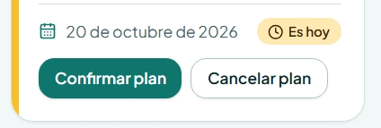
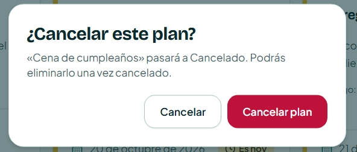
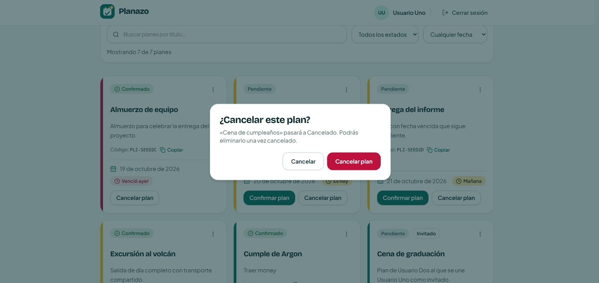

# Tarea de Clase 16: Decisiones de Interacción (IHC)

**Asignatura:** Interacción Humano-Computador  
**Proyecto:** Planazo  
**Flujos evaluados:** Cancelar, estados del plan, detalle y confirmación (`/mis-planes`)  
**Principios evaluados:** Ley de Fitts, Ley de Hick y Teoría de la Carga Cognitiva  

---

## 1. Descripción de la Tarea

Ejercicio práctico de evaluación y diseño de interacción en clase enfocado en la toma de decisiones basada en leyes ergonómicas y psicológicas de la interacción humano-computador. Se analizaron los flujos críticos de **cancelación, gestión de estados del plan y diálogos de confirmación** en **Planazo** bajo tres principios fundamentales:

1. **Ley de Fitts:** Dificultad motriz para alcanzar o accionar controles según su tamaño físico y distancia.
2. **Ley de Hick:** Tiempo invertido en tomar decisiones frente a un conjunto de opciones concurrentes o ambiguas.
3. **Carga Cognitiva:** Esfuerzo de memoria de trabajo requerido para interpretar o recordar datos en puntos de decisión.

Siguiendo la consigna docente, se documentan los 3 hallazgos con sus capturas obligatorias y justificaciones técnicas, manteniéndose en estado **Documentado** para el **Commit 1**, y se define la priorización de uno de ellos para su corrección técnica en el **Commit 2**.

---

## 2. Tabla Resumen de Hallazgos de Interacción

| Hallazgo | Captura obligatoria | Justificación breve | Estado al terminar |
| :--- | :--- | :--- | :---: |
| **Fitts** | **Acción difícil de alcanzar** Evidencia: [`Fitts-antes.jpeg`](evidencias/clase-16/Fitts-antes.jpeg) | **Tamaño, distancia o área activa:** Los botones de acción rápida en la tarjeta (`PlanCard.tsx`) usan variante compacta de solo 36px de altura y están contiguos a 8px, reduciendo el área activa y dificultando la selección táctil precisa de acciones destructivas («Cancelar plan»). | **Documentado** |
| **Hick** *(Priorizado)* | **Opciones que compiten** Evidencia: [`Hick-antes.jpeg`](evidencias/clase-16/Hick-antes.jpeg) | **Cantidad, agrupación o prioridad:** En el modal de confirmación de cancelación (`ConfirmDialog.tsx`), el botón de descarte se titula «Cancelar» y el botón destructivo «Cancelar plan». Ambas opciones compiten en paridad léxica en el mismo nivel visual, generando vacilación cognitiva sobre cuál anula el modal y cuál el plan. | **Documentado** |
| **Carga cognitiva** | **Información que exige esfuerzo** Evidencia: [`Carga-Cognitiva-antes.jpeg`](evidencias/clase-16/Carga-Cognitiva-antes.jpeg) | **Qué debe recordar, interpretar o comparar:** El diálogo de cancelación oscurece la tarjeta y no recapitula la fecha límite, estado de participantes ni consecuencias para invitados; el usuario debe recordar mentalmente los datos del evento antes de confirmar la baja definitiva. | **Documentado** |

---

## 3. Fichas Detalladas de los Hallazgos

### 🎯 Hallazgo 1: Ley de Fitts (Acción difícil de alcanzar)

* **Pantalla y contexto:** Vista principal de `/mis-planes`, tarjeta de plan [`PlanCard.tsx`](../apps/frontend/src/components/domain/PlanCard.tsx#L230-L245).
* **Elemento evaluado:** Botones de acción en tarjetas en estado pendiente («Confirmar plan» y «Cancelar plan»).
* **Comportamiento observado:**
  * En la zona inferior de cada tarjeta, los botones se renderizan con la clase `size="sm"` (`min-h-9 px-3.5 py-1.5` de [`button.tsx`](../apps/frontend/src/components/ui/button.tsx#L22-L27)), lo que representa una altura física efectiva de únicamente **36px**.
  * Ambos botones se encuentran adyacentes en una fila con una separación horizontal de apenas **8px** (`gap-2`).
* **Justificación técnica:**
  * La **Ley de Fitts** modela matemáticamente el tiempo de adquisición de un objetivo como:
    $$T = a + b \log_2\left(\frac{2D}{W}\right)$$
    donde $D$ es la distancia al objetivo y $W$ es su tamaño/ancho proyectado en la dirección del movimiento.
  * Con una altura $W = 36\text{px}$, el control incumple las recomendaciones internacionales de accesibilidad y ergonomía (WCAG 2.5.5 Target Size mínimo de 44×44px y Apple/Material Design de 48×48px).
  * Debido a la escasa distancia ($D = 8\text{px}$) entre una acción positiva («Confirmar plan») y una destructiva («Cancelar plan»), el usuario que interactúa en dispositivos móviles o trackpads tiene una probabilidad estadísticamente elevada de incurrir en toques accidentales (*misclicks*) sobre la acción equivocada.
* **Estado:** Documentado.

---

### ⚡ Hallazgo 2: Ley de Hick (Opciones que compiten — Priorizado para Fix)

* **Pantalla y contexto:** Modal de confirmación invocado al solicitar la cancelación de un plan ([`PlanCard.tsx`](../apps/frontend/src/components/domain/PlanCard.tsx#L282-L295) y [`ConfirmDialog.tsx`](../apps/frontend/src/components/domain/ConfirmDialog.tsx#L51-L71)).
* **Elemento evaluado:** Opciones de decisión en el pie del diálogo modal (`AlertDialog.Cancel` vs `AlertDialog.Action`).
* **Comportamiento observado:**
  * Al hacer clic en «Cancelar plan», se despliega el diálogo con el título *«¿Cancelar este plan?»*.
  * En el footer del diálogo aparecen dos botones que compiten directamente en el mismo plano visual:
    1. Botón neutro: **«Cancelar»** (función: descartar el modal y mantener el plan activo).
    2. Botón destructivo: **«Cancelar plan»** (función: procesar la baja del plan).
* **Justificación técnica:**
  * La **Ley de Hick** establece que el tiempo requerido para tomar una decisión es función logarítmica de las alternativas y su diferenciación:
    $$T = b \log_2(n + 1)$$
  * Cuando las alternativas presentan **colisión léxica directa** (ambas utilizan el término *"Cancelar"*), la sobrecarga de discriminación aumenta sensiblemente. El usuario se ve obligado a pausar la interacción para resolver la ambigüedad: *«¿"Cancelar" cancela el plan o cancela la ventana?»*.
  * La ausencia de una jerarquía semántica inequívoca incrementa el tiempo de reacción ($T$) y la tasa de error en un punto crítico irreversible del sistema.
* **Propuesta de solución técnica (Commit 2):**
  * Habilitar la personalización de la acción de descarte en `ConfirmDialog` mediante la propiedad `cancelLabel?: string`.
  * En la invocación de cancelación de `PlanCard.tsx`, renombrar el botón de escape a **«Mantener plan»** (o «Volver») y el botón destructivo a **«Sí, cancelar plan»**, eliminando toda paridad léxica y dejando clara la prioridad de ambas opciones.
* **Estado:** Documentado (Priorizado para resolver en el Commit 2).

---

### 🧠 Hallazgo 3: Carga Cognitiva (Información que exige esfuerzo innecesario)

* **Pantalla y contexto:** Diálogo de confirmación [`ConfirmDialog.tsx`](../apps/frontend/src/components/domain/ConfirmDialog.tsx#L41-L45) en la cancelación de planes.
* **Elemento evaluado:** Texto explicativo y contexto ofrecido al usuario antes de ejecutar la acción.
* **Comportamiento observado:**
  * El modal se limita a indicar: *«"Nombre del plan" pasará a Cancelado. Podrás eliminarlo una vez cancelado.»*
  * El backdrop oscurecido (`bg-ink/55`) tapa la tarjeta original donde figuraban la fecha de vencimiento (`dueDate`) y la lista de participantes unidos.
* **Justificación técnica:**
  * Según la **Teoría de la Carga Cognitiva** (Sweller) y los límites de la memoria de trabajo humana ($7 \pm 2$ piezas de información según Miller), el diseño no debe forzar al usuario a recordar datos que el sistema conoce.
  * Para determinar si es prudente cancelar el plan en ese instante, el usuario necesita saber si el evento era inminente (*"Es hoy"*, *"Mañana"*) y si afectará a invitados ya confirmados. Al ocultar estos datos tras el modal sin recapitulárselos, el sistema genera **carga cognitiva extrínseca innecesaria**, forzando al usuario a cancelar a ciegas o abortar el diálogo para re-inspeccionar la tarjeta y volver a comenzar.
* **Estado:** Documentado.

---

## 4. Registro Visual de Evidencias

Las capturas de respaldo correspondientes al estado inicial evaluado se encuentran enlazadas a continuación:

### 1. Evidencia Fitts: Área activa y proximidad de botones

* Botones de acción «Confirmar plan» y «Cancelar plan» en tarjeta de plan (`size="sm"`, 36px de alto, 8px de separación):  
  

---

### 2. Evidencia Hick: Conflicto de opciones con colisión léxica

* Diálogo modal mostrando dos botones contiguos en conflicto léxico («Cancelar» vs «Cancelar plan»):  
  

---

### 3. Evidencia Carga Cognitiva: Omisión de contexto crítico en confirmación

* Diálogo de confirmación con backdrop oscurecido sin información de fecha ni participantes:  
  

---

## 5. Selección y Priorización del Hallazgo a Resolver

Para el **Commit 2**, el equipo prioriza la resolución del **Hallazgo 2 (Ley de Hick)** por los siguientes motivos pedagógicos y de diseño:

1. **Criticidad en flujos destructivos:** La ambigüedad entre *"Cancelar"* (cerrar ventana) y *"Cancelar plan"* (destruir/bajar plan) es uno de los anti-patrones de diálogo más documentados en usabilidad, capaz de inducir pérdidas accidentales de estado en usuarios reales.
2. **Impacto inmediato en la velocidad de decisión:** Eliminar la colisión léxica mediante etiquetas orientadas a objetivos («Mantener plan» vs. «Sí, cancelar plan») reduce a cero la vacilación del usuario conforme a la Ley de Hick.
3. **Verificabilidad y cobertura automatizada:** Permite actualizar de forma limpia la arquitectura del componente reutilizable `ConfirmDialog` y asegurar el flujo con pruebas unitarias exhaustivas en Vitest.
