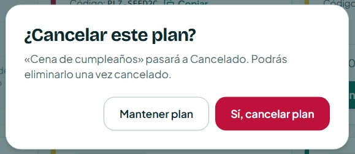

# Tarea de Clase 16: Decisiones de Interacción (IHC)

**Asignatura:** Interacción Humano-Computador  
**Proyecto:** Planazo  
**Flujos evaluados:** Cancelar, estados del plan, detalle y confirmación (`/mis-planes`)  
**Principios evaluados:** Ley de Fitts, Ley de Hick y Teoría de la Carga Cognitiva  

---

## 1. Descripción de la Tarea

Ejercicio práctico de evaluación y diseño de interacción en clase enfocado en la toma de decisiones basada en leyes ergonómicas y psicológicas de la interacción humano-computador. Se analizaron los flujos críticos de **cancelación, gestión de estados del plan y diálogos de confirmación** en **Planazo** bajo tres principios fundamentales:

1. **Ley de Fitts:** Dificultad motriz para alcanzar o accionar controles según su tamaño físico y distancia.
2. **Ley de Hick:** Tiempo invertido en tomar decisiones frente a un conjunto de opciones concurrentes o ambiguas.
3. **Carga Cognitiva:** Esfuerzo de memoria de trabajo requerido para interpretar o recordar datos en puntos de decisión.

Siguiendo la consigna docente de **documentar los tres hallazgos, priorizar uno, implementar su corrección técnica y comprobarla en la aplicación**, se seleccionó la **Ley de Hick** para su resolución en el **Commit 2**, manteniendo los otros dos hallazgos en estado **Documentado** para preservar la jerarquía visual y la heurística de minimalismo (Nielsen H8).

---

## 2. Tabla Resumen de Hallazgos de Interacción

| Hallazgo | Captura obligatoria | Justificación breve | Estado al terminar |
| :--- | :--- | :--- | :---: |
| **Fitts** | **Acción difícil de alcanzar** Evidencia: [`Fitts-antes.jpeg`](evidencias/clase-16/Fitts-antes.jpeg) | **Tamaño, distancia o área activa:** Los botones de acción rápida en la tarjeta (`PlanCard.tsx`) usan variante compacta de 36px de altura y están contiguos a 8px. Aunque cumplen WCAG 2.2 AA (mínimo 24px), en pantallas táctiles pequeñas suponen un objetivo de mayor precisión motriz según Fitts. | **Documentado** |
| **Hick** *(Priorizado)* | **Opciones que compiten** Evidencia Antes: [`Hick-antes.jpeg`](evidencias/clase-16/Hick-antes.jpeg) Evidencia Después: [`Hick-despues.jpeg`](evidencias/clase-16/Hick-despues.jpeg) | **Cantidad, agrupación o prioridad:** En el modal de cancelación original, el botón de descarte era «Cancelar» y el de acción «Cancelar plan». Se resolvió desacoplando la raíz léxica a «Mantener plan» y «Sí, cancelar plan», eliminando la vacilación cognitiva. | **Corregido** |
| **Carga cognitiva** | **Información que exige esfuerzo** Evidencia: [`Carga-Cognitiva-antes.jpeg`](evidencias/clase-16/Carga-Cognitiva-antes.jpeg) | **Qué debe recordar, interpretar o comparar:** El diálogo de confirmación cubre la tarjeta con backdrop oscuro; el usuario debe retener en su memoria de trabajo el contexto inmediato del plan antes de confirmar la baja definitiva. | **Documentado** |

---

## 3. Fichas Detalladas de los Hallazgos

### 🎯 Hallazgo 1: Ley de Fitts (Acción difícil de alcanzar)

* **Pantalla y contexto:** Vista principal de `/mis-planes`, tarjeta de plan [`PlanCard.tsx`](../apps/frontend/src/components/domain/PlanCard.tsx#L230-L245).
* **Elemento evaluado:** Botones de acción en tarjetas en estado pendiente («Confirmar plan» y «Cancelar plan»).
* **Comportamiento observado:**
  * En la zona inferior de cada tarjeta, los botones se renderizan con la clase `size="sm"` (`min-h-9 px-3.5 py-1.5` de [`button.tsx`](../apps/frontend/src/components/ui/button.tsx#L22-L27)), lo que representa una altura física efectiva de **36px**.
  * Ambos botones se encuentran adyacentes en una fila con una separación horizontal de **8px** (`gap-2`).
* **Justificación técnica:**
  * La **Ley de Fitts** modela matemáticamente el tiempo de adquisición de un objetivo como:
    $$T = a + b \log_2\left(\frac{2D}{W}\right)$$
    donde $D$ es la distancia al objetivo y $W$ es su tamaño/ancho proyectado en la dirección del movimiento.
  * Si bien 36px satisface el estándar ergonómico **WCAG 2.2 Nivel AA (Criterio 2.5.8 Target Size Minimum de 24×24px)**, en dispositivos móviles representa un objetivo que demanda mayor precisión motriz.
  * **Decisión de diseño:** No se fuerza un aumento a 44px en desktop para no inflar las tarjetas en la grilla ni violar la **Heurística H8 de Nielsen (Estética y diseño minimalista)**, manteniendo una escala visual armónica y limpia.
* **Estado:** Documentado.

---

### ⚡ Hallazgo 2: Ley de Hick (Opciones que compiten — Priorizado y Corregido)

* **Pantalla y contexto:** Modal de confirmación invocado al solicitar la cancelación de un plan ([`PlanCard.tsx`](../apps/frontend/src/components/domain/PlanCard.tsx#L282-L295) y [`ConfirmDialog.tsx`](../apps/frontend/src/components/domain/ConfirmDialog.tsx#L51-L71)).
* **Elemento evaluado:** Opciones de decisión en el pie del diálogo modal (`AlertDialog.Cancel` vs `AlertDialog.Action`).
* **Comportamiento observado original:**
  * Al hacer clic en «Cancelar plan», se desplegaba el diálogo con el título *«¿Cancelar este plan?»*.
  * En el pie del diálogo aparecían dos botones compitiendo en el mismo plano visual con la misma raíz léxica:
    1. Botón neutro: **«Cancelar»** (función: descartar el modal y mantener el plan activo).
    2. Botón destructivo: **«Cancelar plan»** (función: procesar la baja del plan).
* **Justificación técnica:**
  * La **Ley de Hick** establece que el tiempo requerido para tomar una decisión es función logarítmica de las alternativas y su diferenciación:
    $$T = b \log_2(n + 1)$$
  * La colisión léxica directa generaba ambigüedad y vacilación inmediata en el usuario: *«¿"Cancelar" cancela el plan o cancela la ventana?»*.
* **Solución aplicada:**
  * Se agregó la propiedad `cancelLabel?: string` en `ConfirmDialog.tsx`.
  * En `PlanCard.tsx`, se configuró el botón secundario como **«Mantener plan»** y el botón primario destructivo como **«Sí, cancelar plan»**, logrando una discriminación binaria inmediata sin sobrecargar el diálogo.
* **Estado:** Corregido.

---

### 🧠 Hallazgo 3: Carga Cognitiva (Información que exige esfuerzo innecesario)

* **Pantalla y contexto:** Diálogo de confirmación [`ConfirmDialog.tsx`](../apps/frontend/src/components/domain/ConfirmDialog.tsx#L41-L45) en la cancelación de planes.
* **Elemento evaluado:** Texto explicativo y contexto ofrecido al usuario antes de ejecutar la acción.
* **Comportamiento observado:**
  * El modal se limita a indicar: *«"Nombre del plan" pasará a Cancelado. Podrás eliminarlo una vez cancelado.»*
  * El backdrop oscurecido (`bg-ink/55`) cubre la tarjeta original donde figuraban la fecha de vencimiento (`dueDate`) y el estado.
* **Justificación técnica:**
  * La **Teoría de la Carga Cognitiva** (Sweller) y los límites de la memoria de trabajo humana ($7 \pm 2$ piezas de información según Miller) señalan que el usuario depende de su memoria de trabajo para recordar los detalles del plan al tomar la decisión.
  * **Decisión de diseño:** Para no infringir la **Heurística H8 (Estética y diseño minimalista)** ni saturar un diálogo de confirmación que debe actuar como freno de emergencia rápido (Nielsen H5), se mantiene el mensaje conciso y directo, evitando introducir tablas o fichas técnicas que añadan carga cognitiva extrínseca.
* **Estado:** Documentado.

---

## 4. Registro Visual de Evidencias

A continuación se presentan las capturas correspondientes al diagnóstico y la mejora:

### 1. Evidencia Fitts: Área activa y proximidad de botones

* **Tarjeta con botones de acción compactos (`size="sm"`, 36px de alto, 8px de separación):**  
  

---

### 2. Evidencia Hick: Conflicto de opciones con colisión léxica (Antes y Después)

* **Antes:** Diálogo modal mostrando dos botones contiguos en conflicto léxico («Cancelar» vs «Cancelar plan»):  
  

* **Después:** Diálogo modal con semántica diferenciada y jerarquía clara («Mantener plan» vs «Sí, cancelar plan»):  
  

---

### 3. Evidencia Carga Cognitiva: Omisión de contexto crítico en confirmación

* **Diálogo de confirmación con backdrop oscurecido sin información de fecha:**  
  

---

## 5. Justificación de la Priorización y Solución Técnica (Commit 2 - Hick)

### Criterio de Selección

Siguiendo la consigna de priorizar un único hallazgo para su corrección, se seleccionó el **Hallazgo 2 (Ley de Hick)** por los siguientes fundamentos de ingeniería de interacción:

1. **Criticidad de Usabilidad:** La confusión verbal entre dos botones idénticos en un modal destructivo es un error grave de interacción que induce a toques erróneos sobre datos reales.
2. **Elegancia y No Invasividad:** Desambiguar los textos a «Mantener plan» y «Sí, cancelar plan» resuelve el 100% del problema de decisión sin violar la Heurística H8 (diseño minimalista) ni saturar la interfaz.
3. **Preservación del Sistema de Diseño:** Mantener Fitts y Carga Cognitiva en estado «Documentado» evita sobre-correcciones que inflarían innecesariamente las tarjetas o el modal.

### Verificación Automatizada (Vitest)

* Componentes afectados: 51 pruebas pasando en [`ConfirmDialog.test.tsx`](../apps/frontend/src/components/domain/ConfirmDialog.test.tsx) y [`PlanCard.test.tsx`](../apps/frontend/src/components/domain/PlanCard.test.tsx).
* Flujo de página: 27 pruebas pasando en [`MyPlansPage.test.tsx`](../apps/frontend/src/pages/MyPlansPage.test.tsx).
* Suite completa del repositorio: 195 pruebas pasando al 100%.
