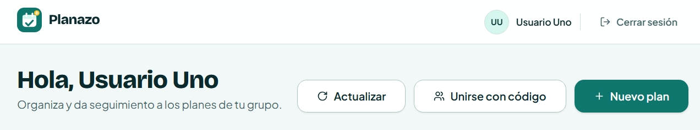
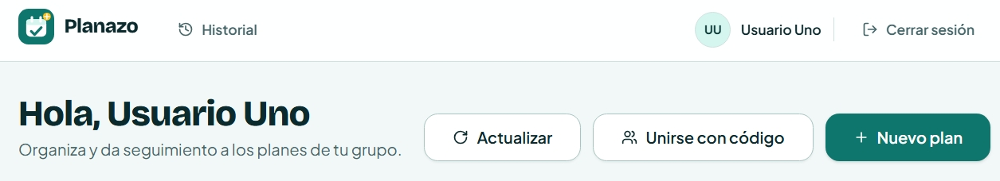
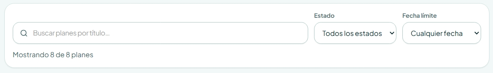
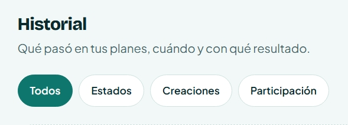
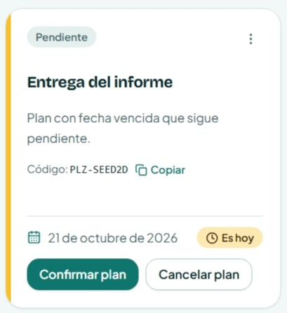
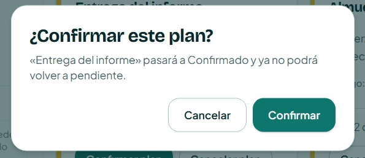
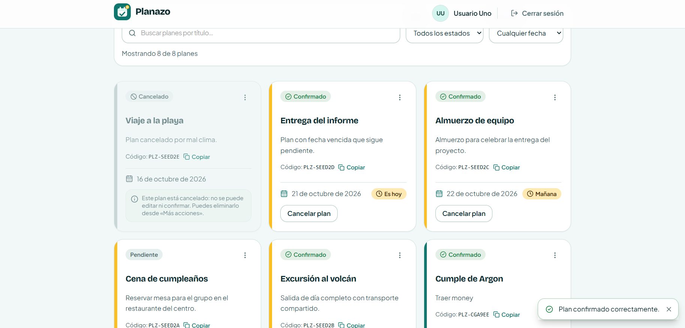
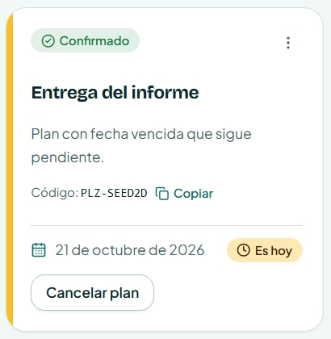
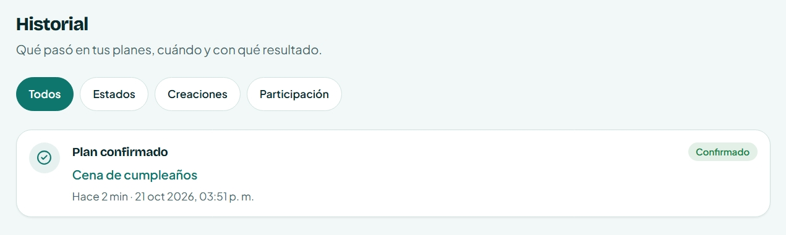
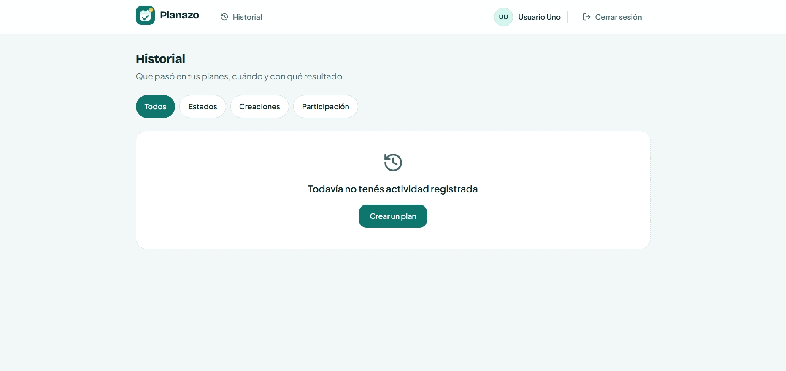

# Decisiones de Interacción: Historial de Actividad (IHC)

**Asignatura:** Interacción Humano-Computador  
**Proyecto:** Planazo  
**Funcionalidad:** Historial de actividad de planes («¿Qué cambios tuvo el plan y cuándo?»)  
**Issue de Referencia:** Issue principal [#24](https://github.com/moises-cisneros/Proyecto-2-IHC/issues/24) y sub-issues [#25](https://github.com/moises-cisneros/Proyecto-2-IHC/issues/25), [#26](https://github.com/moises-cisneros/Proyecto-2-IHC/issues/26), [#27](https://github.com/moises-cisneros/Proyecto-2-IHC/issues/27), [#28](https://github.com/moises-cisneros/Proyecto-2-IHC/issues/28)  
**Principios Evaluados:** Ley de Fitts, Ley de Hick y Teoría de la Carga Cognitiva  

---

## 1. Descripción y Propósito

Este documento registra formalmente las decisiones de diseño de interacción tomadas para la construcción del **Historial de Actividad** en Planazo. La funcionalidad responde a la necesidad central del usuario: **«¿Qué cambios tuvo el plan y cuándo?»** desplegando en cada evento sus cuatro dimensiones críticas:

1. **Qué ocurrió:** Acción semántica (creación, cambio de estado, confirmación, cancelación, unión de miembro).
2. **Cuándo ocurrió:** Momento legible en español (fecha/hora y tiempo relativo).
3. **Cuál fue el resultado:** Estado o consecuencia del evento.
4. **Qué elemento estuvo involucrado:** Nombre/título del plan afectado con acceso directo.

Para evitar diseños ingenuos o convencionales que degraden la usabilidad, la solución se estructuró contrastando una **alternativa base (Antes)** frente a la **solución ergonómica implementada (Después)** bajo los tres principios evaluados.

---

## 2. Resumen de Decisiones de Interacción

| Principio | Línea Base / Alternativa Ingenua (Antes) | Decisión Ergonómica Implementada (Después) | Evidencias | Estado |
| :--- | :--- | :--- | :---: | :---: |
| **Ley de Fitts** | **Acceso oculto o target reducido (< 24px):** El usuario debe navegar menús anidados o pulsar iconos diminutos sin área táctil suficiente. | **Acceso directo con target $\ge 44$px:** Botón/enlace prominente en navegación principal con `min-h-[44px]` y padding ergonómico táctil. | [`Fitts-antes.jpeg`](evidencias/historial/Fitts-antes.jpeg) [`Fitts-despues.jpeg`](evidencias/historial/Fitts-despues.jpeg) | **Implementado** |
| **Ley de Hick** | **Filtros masivos compitiendo sin orden ($n > 8$):** Selector plano o lista no categorizada que incrementa el tiempo de decisión. | **Chips temáticos agrupados ($n = 4$):** Categorías semánticas (`Todos`, `Estados`, `Creaciones`, `Participación`) con filtrado en un clic. | [`Hick-antes.jpeg`](evidencias/historial/Hick-antes.jpeg) [`Hick-despues.jpeg`](evidencias/historial/Hick-despues.jpeg) | **Implementado** |
| **Carga Cognitiva** | **Sin trazabilidad / log crudo técnico:** El usuario debe recordar de memoria estados previos o descifrar IDs técnicos tras realizar cambios. | **Tarjeta autónoma con 4 dimensiones:** Tarjeta auto-explicativa con ícono semántico, fecha legible, badge de estado y deep-link con auto-scroll y resalte a la tarjeta del plan. | [`P1`](evidencias/historial/Carga-Cognitiva-antes-P1.jpeg), [`P2`](evidencias/historial/Carga-Cognitiva-antes-P2.jpeg), [`P3`](evidencias/historial/Carga-Cognitiva-antes-P3.png), [`P4`](evidencias/historial/Carga-Cognitiva-antes-P4.jpeg) [`Carga-Cognitiva-despues.jpeg`](evidencias/historial/Carga-Cognitiva-despues.jpeg) | **Implementado** |

---

## 3. Fichas Técnicas Detalladas

### 🎯 1. Ley de Fitts: Tamaño, distancia y área activa del acceso

* **Ubicación en código:** `apps/frontend/src/components/domain/Navbar.tsx`.
* **Problema base (Antes):**
  * En una implementación convencional, el historial suele ubicarse en un menú desplegable secundario del usuario o representarse con un icono pequeño (24px o menos), demandando alta precisión motriz:
  * Formulación de Fitts:
    $$T = a + b \log_2\left(\frac{2D}{W}\right)$$
  * Al ser el ancho proyectado $W$ pequeño y la distancia $D$ mayor por exigir un clic previo para abrir el menú, el tiempo de adquisición $T$ se eleva.
* **Solución aplicada (Después):**
  * Se incorpora un acceso visible directo a `/historial` en la barra de navegación con un área de contacto mínima de **44×44px** (cumpliendo con la recomendación de accesibilidad ergonómica de WCAG 2.5.5 y Material Design).
  * En dispositivos móviles, el control se posiciona en una zona de alcance natural del pulgar.
* **Evidencias:** `Fitts-antes.jpeg` vs `Fitts-despues.jpeg`.

---

### ⚡ 2. Ley de Hick: Organización de filtros y tiempo de decisión

* **Ubicación en código:** `apps/frontend/src/pages/ActivityHistoryPage.tsx`.
* **Problema base (Antes):**
  * Presentar todos los posibles tipos de eventos en un selector masivo o lista plana (ej. 8 a 10 opciones simultáneas sin agrupar) aumenta el tiempo de selección según la Ley de Hick:
    $$T = b \log_2(n + 1)$$
  * Con $n = 10$, el usuario experimenta parálisis de decisión y fatiga visual intentando discernir entre opciones técnicas granulares.
* **Solución aplicada (Después):**
  * Se diseñó un conjunto acotado de **4 chips temáticos priorizados**:
    1. `Todos`: Vista cronológica global completa.
    2. `Estados`: Transiciones de estado (confirmado, cancelado).
    3. `Creaciones`: Planes recién creados o editados.
    4. `Participación`: Miembros unidos o abandonos.
  * Al reducir $n$ a 4 bloques con jerarquía visual clara, el usuario toma decisiones binarias o de bajo costo cognitivo en un solo toque.
* **Evidencias:** `Hick-antes.jpeg` vs `Hick-despues.jpeg`.

---

### 🧠 3. Carga Cognitiva: Tarjeta autónoma y reconocimiento sobre recuerdo

* **Ubicación en código:** `apps/frontend/src/components/domain/ActivityCard.tsx`.
* **Problema base (Antes):**
  * Previo a la feature, el usuario de Planazo debía recordar de memoria si un plan estaba en borrador o confirmado, o abrir plan por plan para enterarse de cambios.
  * En sistemas con logs rudimentarios, los registros suelen mostrar textos crudos (ej. `"Evento PLAN_STATUS_UPDATED en plan ID #3f8a"`), forzando al usuario a retener en memoria de trabajo ($7 \pm 2$ piezas según Miller/Sweller) qué plan era o qué consecuencias tuvo el cambio.
* **Solución aplicada (Después):**
  * Cada tarjeta de actividad sintetiza de forma autónoma las **4 dimensiones**:
    * **Qué:** Título en lenguaje natural con ícono semántico identificable.
    * **Cuándo:** Tiempo relativo legible en español ("Hace 15 min", "Ayer, 18:20").
    * **Resultado:** Badge visual de estado con color contextual (ej. verde confirmado, rojo cancelado).
    * **Elemento involucrado:** Nombre destacado del plan con enlace directo por deep-linking (`/mis-planes#plan-${id}`), posicionando el scroll automáticamente y resaltando la tarjeta del plan en pantalla (`:target` y foco ergonómico).
  * Se aplica la heurística de **reconocimiento antes que recuerdo (Nielsen H6)**: el usuario comprende el contexto completo sin abandonar la pantalla.
* **Evidencias:** Secuencia paso a paso (`Carga-Cognitiva-antes-P1.jpeg`, `P2.jpeg`, `P3.png`, `P4.jpeg`) vs `Carga-Cognitiva-despues.jpeg`.

---

## 4. Estado Vacío Orientador (Onboarding Heurístico)

* **Ubicación en código:** `apps/frontend/src/pages/ActivityHistoryPage.tsx`.
* Cuando un usuario recién registrado o sin actividad consulta `/historial`, el sistema no presenta una pantalla en blanco ni un mensaje frustrante:
  * Mensaje claro y empático: *«Todavía no tenés actividad registrada en tus planes»*.
  * Call-to-action (CTA) principal: Botón directo a *«Crear un nuevo plan»* o *«Explorar mis planes»*, orientando el siguiente paso ergonómico.
* **Evidencia:** `Estado-Vacio-despues.jpeg`.

---

## 5. Registro Visual de Evidencias

Las capturas comparativas se encuentran almacenadas en el repositorio bajo `docs/evidencias/historial/`:

1. **Ley de Fitts:**
   * **Antes (Acceso sin target ergonómico o ausente):**  
     
   * **Después (Acceso directo $\ge 44$px en navegación):**  
     

2. **Ley de Hick:**
   * **Antes (Opciones no categorizadas / lista masiva):**  
     
   * **Después (Chips temáticos agrupados y priorizados):**  
     

3. **Carga Cognitiva:**
   * **Antes (Secuencia paso a paso - Esfuerzo de memoria de trabajo):**  
     * *Parte 1 (Tarjeta inicial de un plan):*  
         
     * *Parte 2 (Confirmación del plan sin contexto histórico):*  
         
     * *Parte 3 (Pantalla general tras cambio - Sin registro de auditoría):*  
         
     * *Parte 4 (Tarjeta enfocada con nuevo estado sin traza temporal ni actor):*  
       
   * **Después (Tarjeta autónoma con las 4 dimensiones):**  
     

4. **Estado Vacío:**
   * **Después (Pantalla de estado vacío con orientación y acción):**  
     

---

## 6. Verificación Automatizada (Vitest)

La funcionalidad cuenta con pruebas unitarias tanto en backend como en frontend:

* **Backend (`apps/backend/src/services/activity.service.test.ts`):** Validación de persistencia de eventos, aislamiento estricto por usuario y orden cronológico descendente.
* **Frontend (`apps/frontend/src/pages/ActivityHistoryPage.test.tsx`):** Renderizado de las 4 dimensiones, funcionamiento de chips de filtro (Hick), accesibilidad táctil de navegación (Fitts) y renderizado del estado vacío.
