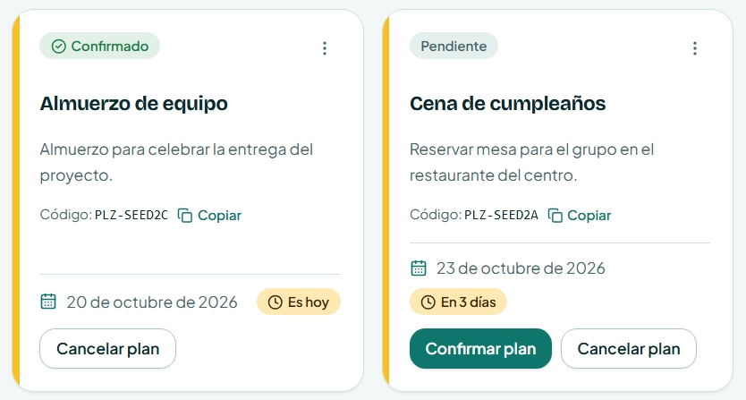
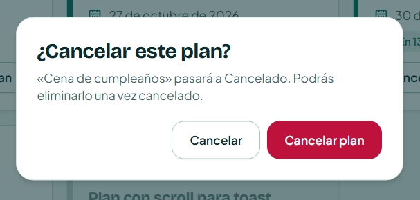
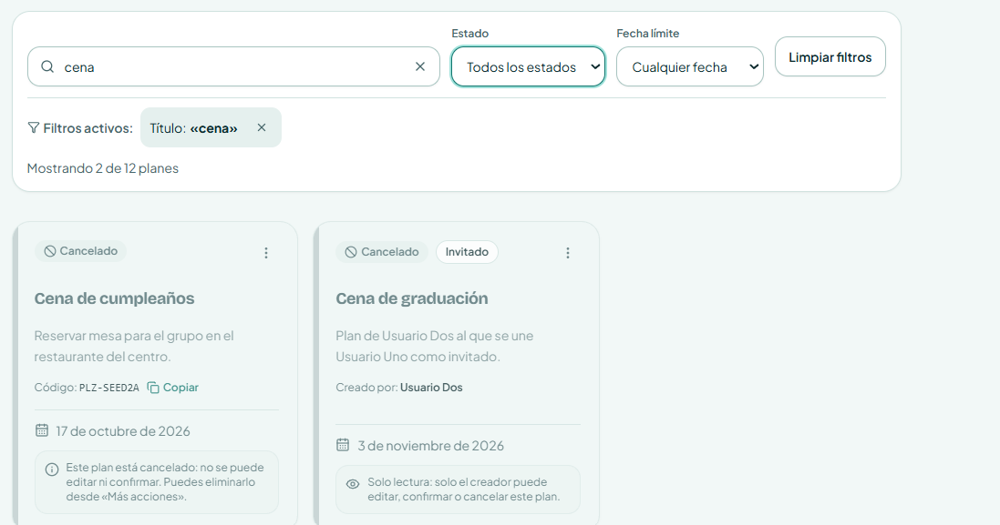
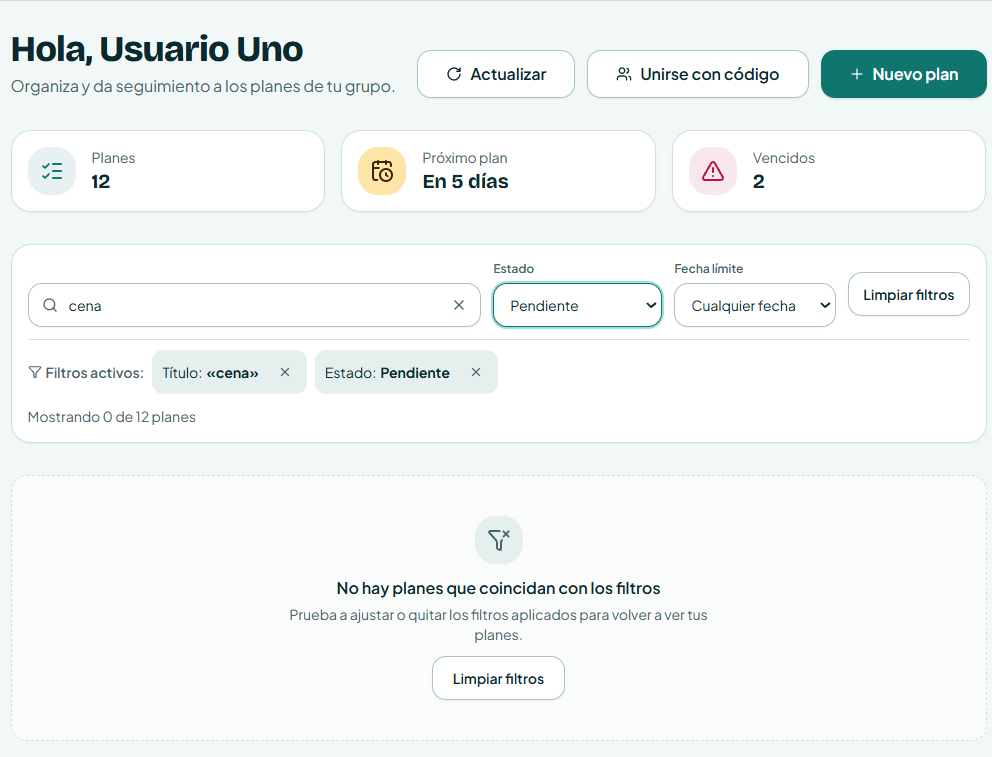
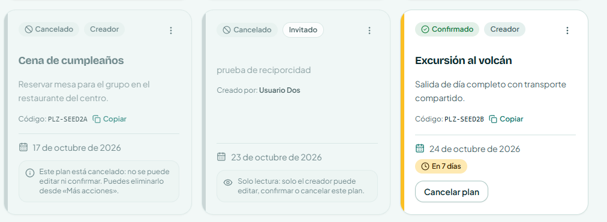
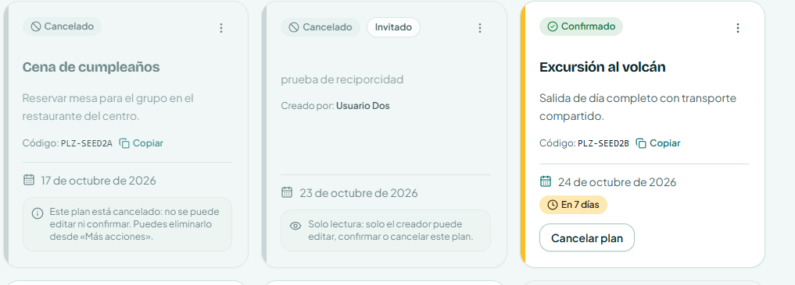
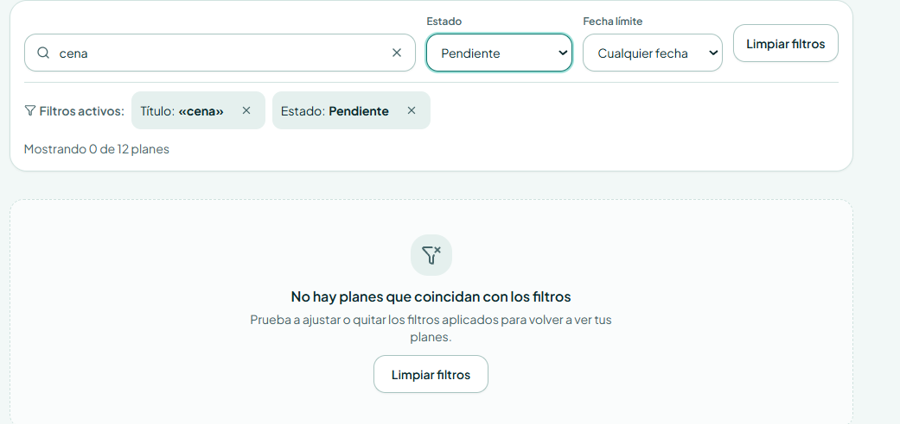
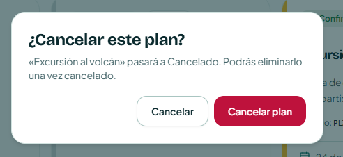
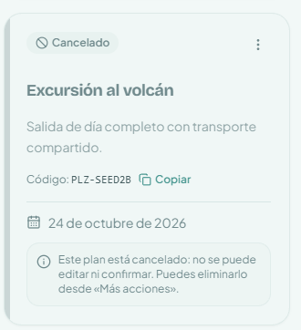

# Evaluación Heurística: Encontrar un Plan y Cancelarlo (H1 - H10)

**Asignatura:** Interacción Humano-Computador (IHC) · Clase 15  
**Proyecto:** Planazo  
**Funcionalidad Evaluada:** Encontrar un plan y cancelarlo (Búsqueda, filtrado y cancelación de planes)  
**Entrega:** Jueves 15 de octubre de 2026  

Este documento registra la evaluación de usabilidad centrada en el flujo crítico **«Encontrar un plan y cancelarlo»** en Planazo, aplicando rigurosamente las **10 Heurísticas de Usabilidad de Jakob Nielsen**. La primera sección presenta el Resumen Ejecutivo con el diagnóstico consolidado del código fuente. La segunda sección detalla el Registro de Evidencias con referencias precisas a componentes, líneas de código y capturas visuales. Finalmente, la tercera sección expone la trazabilidad de los sub-issues atómicos creados para resolver los hallazgos de usabilidad detectados.

---

## Escala de Severidad de Nielsen (0 a 4)

* **0 — No es problema de usabilidad:** Cumple satisfactoriamente la heurística en la funcionalidad evaluada.
* **1 — Cosmético:** Detalle visual o estético menor; se corrige si hay tiempo disponible.
* **2 — Menor:** Dificulta levemente la tarea, pero permite al usuario continuar sin bloqueo.
* **3 — Mayor:** Problema importante de usabilidad; genera confusión o incertidumbre grave en el flujo.
* **4 — Catastrófico:** Bloquea por completo la tarea de encontrar o cancelar el plan.

---

## 1. Resumen Ejecutivo (Tabla)

| Observación | Heurística | Severidad (0-4) | Mejora | Comprobación |
| :--- | :--- | :--- | :--- | :--- |
| **Falta de confirmación contextual al cancelar tras desplazarse:** Al hacer scroll en la lista para buscar un plan y confirmar su cancelación en el modal, el aviso de éxito quedaba fuera del viewport. Se corrigió con un toast flotante anclado a la pantalla. | **H1: Visibilidad del estado del sistema** 🟢 *(Corregida · Sub-issue #17)* | **0 — Corregida (antes 3)** | Notificación flotante accesible (`fixed bottom-5 right-5 z-50 shadow-lg`) anclada en el viewport, que confirma el estado «Cancelado» en cualquier posición de desplazamiento. | Verificado mediante tests unitarios en `MyPlansPage.test.tsx` y captura de pantalla `H1-despues.png` tras desplazarse por la lista. |
| **Vocabulario familiar y fechas en lenguaje cotidiano:** Las fechas de los planes se expresan en lenguaje relativo cotidiano (*"En 3 días"*, *"Es hoy"*, *"Mañana"*), y las acciones emplean términos transparentes (*"Cancelar plan"*, *"Pasará a Cancelado"*). | **H2: Concordancia con el mundo real** ✅ *(Cumple en código)* | **0 — Sin problema** | Mantener vocabulario claro de reuniones y plazos sin exigir interpretación de marcas de tiempo ISO ni códigos técnicos del backend. | Un usuario lee la tarjeta del plan encontrado y comprende de inmediato cuándo vence y en qué estado está sin consultar calendarios externos. |
| **Falta de salida de emergencia para el invitado:** Si un usuario invitado localizaba un plan ajeno al que no podía asistir, la tarjeta solo mostraba un mensaje pasivo sin opción de salida. Se corrigió añadiendo menú contextual y modal de abandono. | **H3: Control y libertad del usuario** 🟢 *(Corregida · Sub-issue #18)* | **0 — Corregida (antes 3)** | Habilitada la opción «Abandonar plan» en el menú (⋮) de la tarjeta para invitados, con diálogo de confirmación (`ConfirmDialog`), feedback contextual y desvinculación vía `POST /api/plans/:id/leave`. | Verificado con tests unitarios en backend y frontend (`PlanCard`, `PlanList`, `MyPlansPage`), typecheck limpio y capturas comparativas `H3-antes.png` y `H3-despues.png`. |
| **Uniformidad visual y funcional en botones y modales:** El botón «Cancelar plan» utiliza consistentemente la variante secundaria (`outline`) según DESIGN.md para no competir con el primario, y el menú (⋮) se posiciona siempre arriba a la derecha. | **H4: Consistencia y estándares** ✅ *(Cumple en código)* | **0 — Sin problema** | Respetar las variantes del sistema de diseño (`tokens.css`, `Button.tsx`, `ConfirmDialog.tsx`) de forma idéntica en todas las tarjetas de la lista. | El usuario escanea la grilla de planes encontrados e identifica de inmediato la jerarquía de botones de acción sin vacilar. |
| **Prevención activa contra cancelaciones accidentales:** El sistema exige confirmación explícita mediante un modal destructivo que cita el título del plan, y deshabilita la acción si el plan ya se encuentra cancelado. | **H5: Prevención de errores** ✅ *(Cumple en código)* | **0 — Sin problema** | Diálogo modal de doble confirmación con el nombre entre comillas y bloqueo del botón para planes ya cancelados (`PlanCard.tsx:L241-L248`). | Un usuario pulsa «Cancelar plan» por error y aborta la acción pulsando «Cancelar» o la tecla `Esc` sin alterar el estado del plan. |
| **Visibilidad de filtros y datos clave al buscar:** Los filtros activos de estado y fecha se presentan como etiquetas visibles (*chips*) removibles, y la tarjeta exhibe el nombre y la fecha sin obligar a memorizarlos. | **H6: Reconocimiento antes que recuerdo** ✅ *(Cumple en código)* | **0 — Sin problema** | Mantener los criterios de búsqueda y los datos clave visibles para evitar que el usuario deba recordar qué filtros aplicó previamente. | El usuario localiza su plan y reconoce con exactitud qué criterios de búsqueda están activos observando los chips de la cabecera. |
| **Eficiencia de búsqueda combinada y persistencia en URL:** Búsqueda en tiempo real por texto combinable con filtros de estado (`pendientes`, `confirmados`, `cancelados`) sincronizados en `searchParams`. | **H7: Flexibilidad y eficiencia de uso** ✅ *(Cumple en código)* | **0 — Sin problema** | Sincronización bidireccional en URL para que usuarios frecuentes puedan guardar marcadores con planes filtrados o compartir enlaces directos. | Un usuario copia el enlace filtrado de planes pendientes, lo abre en otra ventana y recupera la vista filtrada de inmediato. |
| **Redundancia visual al escanear la lista de planes:** Todas las tarjetas propias exhibían la insignia «Creador», saturando la cabecera visual al buscar un plan. Se corrigió omitiendo dicha insignia en planes propios y manteniendo solo «Invitado» en planes ajenos. | **H8: Estética y diseño minimalista** 🟢 *(Corregida · Sub-issue #19)* | **0 — Corregida (antes 1)** | Omitida la insignia fija «Creador» en planes propios (`!isOwner ? <Badge variant="outline">Invitado</Badge> : null`), manteniendo una cabecera limpia, ligera y legible. | Verificado con tests unitarios en `PlanCard.test.tsx` (40 tests pasando) y capturas comparativas `H8-Antes.png` y `H8-Despues.png`. |
| **Recuperación inmediata si la búsqueda no arroja resultados:** Si la búsqueda no produce coincidencias, la interfaz explica el motivo de forma clara y ofrece un botón directo «Limpiar filtros». | **H9: Ayudar a recuperarse de errores** ✅ *(Cumple en código)* | **0 — Sin problema** | Mensaje orientativo en estado vacío con botón de recuperación de 1 clic para restablecer la vista sin recargar la página. | El usuario ingresa un término sin coincidencias, hace clic en «Limpiar filtros» y recupera la lista completa al instante. |
| **Orientación sobre el impacto de la cancelación:** El modal de confirmación explica qué significa cancelar (*"«Plan» pasará a Cancelado. Podrás eliminarlo una vez cancelado"*), y la tarjeta cancelada ofrece orientación sobre los siguientes pasos. | **H10: Ayuda y documentación** ✅ *(Cumple en código)* | **0 — Sin problema** | Textos explicativos en el diálogo modal y avisos preventivos en la tarjeta cancelada indicando las acciones disponibles. | El usuario lee la descripción del modal antes de confirmar la cancelación y comprende sus consecuencias sin requerir manuales externos. |

---

## 2. Registro de Evidencias por Heurística (H1 a H10)

### H1: Visibilidad del estado del sistema

* **Estado:** 🟢 **Corregida (Resuelto en Sub-issue #17)**
* **Severidad:** **0 — Corregida (original: 3 — Mayor)**
* **Pantalla y flujo:** Catálogo de planes en `/mis-planes`. Paso: el usuario busca un plan en la lista, se desplaza hacia abajo con scroll, pulsa «Cancelar plan» y confirma en el diálogo modal.
* **Problema en código previo (Antes):** En [MyPlansPage.tsx](../apps/frontend/src/pages/MyPlansPage.tsx), el componente `SuccessNotice` estaba ubicado de forma estática en la parte superior del layout. Si el usuario confirmaba la cancelación tras haberse desplazado hacia abajo en la lista, el modal se cerraba pero la alerta de confirmación quedaba oculta arriba, fuera del viewport, privando al usuario de retroalimentación inmediata sobre el resultado de su acción.
* **Solución implementada (Después):** Se encapsuló `SuccessNotice` en [MyPlansPage.tsx:L175-L179](../apps/frontend/src/pages/MyPlansPage.tsx#L175-L179) dentro de un contenedor flotante anclado al viewport (`fixed bottom-5 right-5 z-50 max-w-[calc(100vw-2.5rem)] sm:max-w-md shadow-lg animate-in fade-in slide-in-from-bottom-2 duration-200`) y se configuró un fondo opaco `bg-card` en [Notices.tsx:L40](../apps/frontend/src/components/domain/Notices.tsx#L40). De esta forma, el usuario recibe retroalimentación inmediata e inequívoca tras cancelar el plan, sin importar su nivel de desplazamiento en la página.
* **Referencia al código:** [MyPlansPage.tsx:L175-L179](../apps/frontend/src/pages/MyPlansPage.tsx#L175-L179) y [Notices.tsx:L40](../apps/frontend/src/components/domain/Notices.tsx#L40).
* **Evidencias gráficas:**
  * *Antes (Secuencia de falla: falta de feedback contextual con desplazamiento):*  
    * **Paso 1 (Modal de cancelación tras scroll):**  
        
    * **Paso 2 (Ausencia de feedback en viewport tras confirmar):**  
        
    * **Paso 3 (Desplazamiento forzado hasta el tope para ver el mensaje):**  
      
  * *Después (Notificación toast flotante en viewport tras la corrección):*  
    * **Confirmación flotante visible en viewport con scroll activo:**  
      

---

### H2: Concordancia entre el sistema y el mundo real

* **Estado:** ✅ **Cumple en código**
* **Severidad:** **0 — No es problema**
* **Pantalla y flujo:** Catálogo de planes y diálogo de cancelación. Paso: el usuario busca un plan por su fecha y examina las opciones disponibles.
* **Comprobación en código actual:** En [plans.ts:L9-L54](../apps/frontend/src/lib/plans.ts#L9-L54), `formatDueDate` formatea las fechas en lenguaje natural en español sin desfases horarios, mientras que `getDueStatus` genera etiquetas relativas amigables (*"Es hoy"*, *"Mañana"*, *"En 3 días"*, *"Venció ayer"*). En [PlanCard.tsx:L236](../apps/frontend/src/components/domain/PlanCard.tsx#L236), el botón indica de manera inequívoca *"Cancelar plan"*, y el modal en [PlanCard.tsx:L288](../apps/frontend/src/components/domain/PlanCard.tsx#L288) explica que *"pasará a Cancelado"*, prescindiendo de tecnicismos de bases de datos o identificadores internos.
* **Referencia al código:** [plans.ts:L9-L54](../apps/frontend/src/lib/plans.ts#L9-L54) y [PlanCard.tsx:L214-L245](../apps/frontend/src/components/domain/PlanCard.tsx#L214-L245).
* **Evidencias gráficas:**  
  

---

### H3: Control y libertad del usuario

* **Estado:** 🟢 **Corregida (Resuelto en Sub-issue #18)**
* **Severidad:** **0 — Corregida (original: 3 — Mayor)**
* **Pantalla y flujo:** Catálogo de planes `/mis-planes`, tarjeta de plan con rol «Invitado». Paso: el usuario invitado busca un plan al que se unió para cancelar su participación y desvincularse.
* **Problema en código previo (Antes):** En [PlanCard.tsx](../apps/frontend/src/components/domain/PlanCard.tsx), cuando `!isOwner`, la tarjeta solo presentaba una nota pasiva de solo lectura y el menú de acciones (⋮) era exclusivo del creador (`isOwner`). Esto dejaba al invitado en un callejón sin salida sin posibilidad de retirarse, careciendo de opciones tanto en la interfaz de usuario como de un endpoint dedicado en el backend.
* **Solución implementada (Después):** Se habilitó el menú de acciones (⋮) también para los usuarios con rol de invitado, incorporando la opción «Abandonar plan». Esta acción se vincula a un modal preventivo (`ConfirmDialog`), se comunica con el endpoint `POST /api/plans/:id/leave` en el backend a través del hook `usePlans.leavePlan`, emite la notificación contextual «Has abandonado el plan.» y actualiza la lista removiendo la tarjeta sin recargar la página.
* **Referencia al código:** [PlanCard.tsx:L168-L175](../apps/frontend/src/components/domain/PlanCard.tsx#L168-L175), [PlanCard.tsx:L314-L327](../apps/frontend/src/components/domain/PlanCard.tsx#L314-L327), [plans.ts:L222-L242](../apps/backend/src/routes/plans.ts#L222-L242) y [plans.service.ts:L419-L430](../apps/backend/src/services/plans.service.ts#L419-L430).
* **Evidencias gráficas:**
  * *Antes (Tarjeta de invitado sin opción para retirarse):*  
    
  * *Después (Menú contextual con opción «Abandonar plan» y confirmación):*  
    

---

### H4: Consistencia y estándares

* **Estado:** ✅ **Cumple en código**
* **Severidad:** **0 — No es problema**
* **Pantalla y flujo:** Barra de búsqueda, grilla de planes y modal de confirmación. Paso: interactuar con los botones de acción para cancelar un plan.
* **Comprobación en código actual:** El diseño se apega estrictamente a [DESIGN.md:L67](../apps/frontend/DESIGN.md#L67). En la tarjeta, «Cancelar plan» emplea la variante secundaria `variant="outline"` ([PlanCard.tsx:L236](../apps/frontend/src/components/domain/PlanCard.tsx#L236)) para no competir visualmente con el botón primario `default`. El color rojo destructivo (`destructive`) se reserva de forma exclusiva para el botón de confirmación irreversible dentro del diálogo modal ([ConfirmDialog.tsx:L50-L60](../apps/frontend/src/components/domain/ConfirmDialog.tsx#L50-L60)). Asimismo, el menú de acciones (⋮) mantiene una ubicación consistente arriba a la derecha en todas las tarjetas.
* **Referencia al código:** [DESIGN.md:L67-L70](../apps/frontend/DESIGN.md#L67-L70), [tokens.css](../apps/frontend/src/tokens.css) y [PlanCard.tsx:L228-L245](../apps/frontend/src/components/domain/PlanCard.tsx#L228-L245).
* **Evidencias gráficas:**  
  

---

### H5: Prevención de errores

* **Estado:** ✅ **Cumple en código**
* **Severidad:** **0 — No es problema**
* **Pantalla y flujo:** Acción de cancelar en la tarjeta de plan. Paso: pulsar el botón «Cancelar plan».
* **Comprobación en código actual:** En [PlanCard.tsx:L282-L295](../apps/frontend/src/components/domain/PlanCard.tsx#L282-L295), la cancelación exige confirmación explícita mediante un modal `ConfirmDialog` que cita el nombre específico del plan entre comillas. En [PlanCard.tsx:L246-L257](../apps/frontend/src/components/domain/PlanCard.tsx#L246-L257), cuando un plan ya ha sido cancelado, el botón desaparece y se despliega una nota informativa estática, imposibilitando cancelarlo dos veces por error o incurrir en estados inconsistentes.
* **Referencia al código:** [PlanCard.tsx:L246-L257](../apps/frontend/src/components/domain/PlanCard.tsx#L246-L257) y [PlanCard.tsx:L282-L295](../apps/frontend/src/components/domain/PlanCard.tsx#L282-L295).
* **Evidencias gráficas:**  
  

---

### H6: Reconocimiento antes que recuerdo

* **Estado:** ✅ **Cumple en código**
* **Severidad:** **0 — No es problema**
* **Pantalla y flujo:** Barra de filtros y modal de cancelación. Paso: filtrar la lista para encontrar el plan y abrir el modal.
* **Comprobación en código actual:** En [PlanFiltersBar.tsx:L40-L60](../apps/frontend/src/components/domain/PlanFiltersBar.tsx#L40-L60), los filtros activos se visualizan como etiquetas visibles (*chips*) con botón de remoción rápida (X). En [PlanCard.tsx:L288](../apps/frontend/src/components/domain/PlanCard.tsx#L288), el diálogo modal repite explícitamente el nombre del plan a cancelar (*"«Cena del viernes» pasará a Cancelado"*), evitando que el usuario deba retener mentalmente cuál tarjeta seleccionó.
* **Referencia al código:** [PlanFiltersBar.tsx:L40-L60](../apps/frontend/src/components/domain/PlanFiltersBar.tsx#L40-L60) y [PlanCard.tsx:L282-L295](../apps/frontend/src/components/domain/PlanCard.tsx#L282-L295).
* **Evidencias gráficas:**  
  

---

### H7: Flexibilidad y eficiencia de uso

* **Estado:** ✅ **Cumple en código**
* **Severidad:** **0 — No es problema**
* **Pantalla y flujo:** Barra de búsqueda y filtrado de planes. Paso: buscar por texto y filtrar por estado simultáneamente.
* **Comprobación en código actual:** En [MyPlansPage.tsx:L52-L62](../apps/frontend/src/pages/MyPlansPage.tsx#L52-L62), los criterios de búsqueda y los filtros seleccionados se sincronizan bidireccionalmente con `searchParams` en la URL. Esto permite a los usuarios frecuentes guardar búsquedas habituales en los marcadores de su navegador, navegar utilizando el historial (atrás/adelante) o compartir enlaces que cargan la vista ya filtrada.
* **Referencia al código:** [PlanFiltersBar.tsx:L60-L120](../apps/frontend/src/components/domain/PlanFiltersBar.tsx#L60-L120) y [MyPlansPage.tsx:L52-L62](../apps/frontend/src/pages/MyPlansPage.tsx#L52-L62).
* **Evidencias gráficas:**  
  

---

### H8: Estética y diseño minimalista

* **Estado:** 🟢 **Corregida (Resuelto en Sub-issue #19)**
* **Severidad:** **0 — Corregida (original: 1 — Cosmético)**
* **Pantalla y flujo:** Grilla de tarjetas en `/mis-planes`. Paso: escanear la lista para localizar el plan que se desea cancelar.
* **Problema en código previo (Antes):** En [PlanCard.tsx](../apps/frontend/src/components/domain/PlanCard.tsx), la interfaz renderizaba `<Badge variant="muted">Creador</Badge>` en cada plan propio. Esta etiqueta resultaba redundante dentro de la vista de planes personales (donde por defecto la mayoría son propios), saturando la cabecera visual de las tarjetas y entorpeciendo el escaneo rápido de la lista.
* **Solución implementada (Después):** Se suprimió la insignia «Creador» en planes propios en [PlanCard.tsx:L104-L108](../apps/frontend/src/components/domain/PlanCard.tsx#L104-L108), conservando únicamente el distintivo de rol cuando el usuario es invitado (`{!isOwner ? <Badge variant="outline" data-testid="guest-badge" className="text-xs">Invitado</Badge> : null}`). Asimismo, se actualizaron las pruebas unitarias en [PlanCard.test.tsx](../apps/frontend/src/components/domain/PlanCard.test.tsx) validando que se mantienen operativos el código de compartir y el botón de copiado sin la etiqueta repetitiva, verificando los 40 tests en verde.
* **Referencia al código:** [PlanCard.tsx:L104-L108](../apps/frontend/src/components/domain/PlanCard.tsx#L104-L108) y [PlanCard.test.tsx:L328-L334](../apps/frontend/src/components/domain/PlanCard.test.tsx#L328-L334).
* **Evidencias gráficas:**
  * *Antes (Insignia repetitiva «Creador» en cada tarjeta propia):*  
    
  * *Después (Cabecera despejada para un escaneo visual ágil):*  
    

---

### H9: Ayudar a los usuarios a reconocer, diagnosticar y recuperarse de errores

* **Estado:** ✅ **Cumple en código**
* **Severidad:** **0 — No es problema**
* **Pantalla y flujo:** Búsqueda sin coincidencias en `/mis-planes`. Paso: ingresar un término de búsqueda o combinación de filtros que no coincide con ningún plan.
* **Comprobación en código actual:** En [PlanList.tsx:L28-L49](../apps/frontend/src/components/domain/PlanList.tsx#L28-L49), cuando ningún plan cumple con los criterios de búsqueda o filtro, se presenta un estado vacío explícito (`"no-match"`) con un mensaje claro en español (*"No hay planes que coincidan con los filtros"*) acompañado de un botón directo `Limpiar filtros` (`onClearFilters`) para restablecer el catálogo completo en un solo clic y sin recargar la página.
* **Referencia al código:** [PlanList.tsx:L28-L49](../apps/frontend/src/components/domain/PlanList.tsx#L28-L49).
* **Evidencias gráficas:**  
  

---

### H10: Ayuda y documentación

* **Estado:** ✅ **Cumple en código**
* **Severidad:** **0 — No es problema**
* **Pantalla y flujo:** Tarjeta de plan cancelado y diálogo modal. Paso: examinar la información orientativa antes y después de cancelar.
* **Comprobación en código actual:** En [PlanCard.tsx:L287-L291](../apps/frontend/src/components/domain/PlanCard.tsx#L287-L291), el diálogo modal expone con claridad qué implicaciones tiene la acción antes de ejecutarla (el plan pasará a cancelado y podrá eliminarse posteriormente). En [PlanCard.tsx:L247-L257](../apps/frontend/src/components/domain/PlanCard.tsx#L247-L257), una vez cancelado el plan, la tarjeta exhibe una nota orientativa accesible con `role="note"` que informa que ya no es posible editarlo ni confirmarlo, pero sí eliminarlo desde el menú «Más acciones».
* **Referencia al código:** [PlanCard.tsx:L247-L257](../apps/frontend/src/components/domain/PlanCard.tsx#L247-L257) y [PlanCard.tsx:L282-L295](../apps/frontend/src/components/domain/PlanCard.tsx#L282-L295).
* **Evidencias gráficas:**  
  * **Explicación de consecuencias en el diálogo de cancelación:**  
      
  * **Aviso contextual orientativo en la tarjeta de un plan ya cancelado:**  
    

---

## 3. Sub-issues y Trazabilidad de Correcciones

Para la funcionalidad **«Encontrar un plan y cancelarlo»**, los hallazgos con severidad mayor a 0 identificados durante la evaluación fueron gestionados y resueltos mediante sub-issues atómicos vinculados al issue padre:

* 📌 **Issue Principal (Madre):**  
  [#16 · Evaluación heurística H1–H10 · Encontrar un plan y cancelarlo](https://github.com/moises-cisneros/Proyecto-2-IHC/issues/16)

A continuación se detalla la trazabilidad completa entre cada heurística corregida, su sub-issue de seguimiento, el Pull Request de integración, el commit de cierre y los archivos modificados:

| Heurística | Sub-issue en GitHub | Pull Request (PR) | Commit de Cierre | Archivos Modificados |
| :--- | :--- | :--- | :--- | :--- |
| **H1: Visibilidad del estado** | [#17 · Feedback visible y contextual al cancelar planes](https://github.com/moises-cisneros/Proyecto-2-IHC/issues/17) | [PR #20 · fix/h1-cancel-visible-feedback](https://github.com/moises-cisneros/Proyecto-2-IHC/pull/20) | `fa56b40` · *fix: ensure visible contextual feedback on plan cancellation (Closes #17, Refs #16)* | [`MyPlansPage.tsx`](../apps/frontend/src/pages/MyPlansPage.tsx), [`Notices.tsx`](../apps/frontend/src/components/domain/Notices.tsx) |
| **H3: Control y libertad** | [#18 · Salida de emergencia para usuarios invitados en planes compartidos](https://github.com/moises-cisneros/Proyecto-2-IHC/issues/18) | [PR #21 · fix/h3-guest-leave-plan](https://github.com/moises-cisneros/Proyecto-2-IHC/pull/21) | `b998a6c` · *fix: add leave plan emergency exit for guest members (Closes #18, Refs #16)* | [`PlanCard.tsx`](../apps/frontend/src/components/domain/PlanCard.tsx), [`usePlans.ts`](../apps/frontend/src/hooks/usePlans.ts), [`plans.ts`](../apps/backend/src/routes/plans.ts), [`plans.service.ts`](../apps/backend/src/services/plans.service.ts) |
| **H8: Estética minimalista** | [#19 · Eliminación de redundancia visual en insignias de tarjetas](https://github.com/moises-cisneros/Proyecto-2-IHC/issues/19) | [PR #23 · ERICK2](https://github.com/moises-cisneros/Proyecto-2-IHC/pull/23) | `8509232` · *fix: remove redundant owner badge and streamline card minimalism (Refs #19, Refs #16)* | [`PlanCard.tsx`](../apps/frontend/src/components/domain/PlanCard.tsx), [`PlanCard.test.tsx`](../apps/frontend/src/components/domain/PlanCard.test.tsx) |
