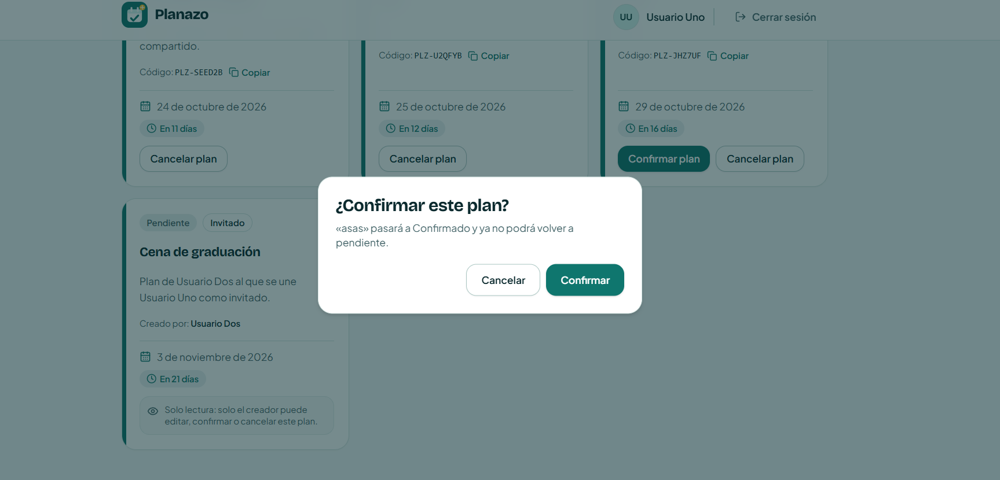
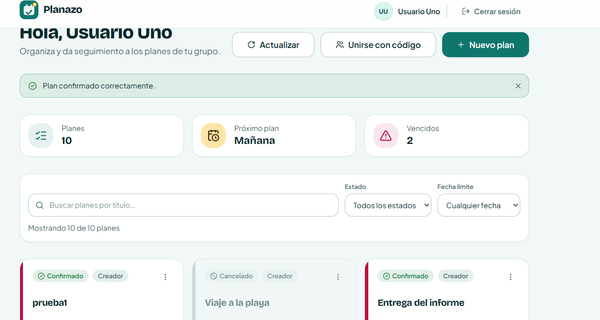
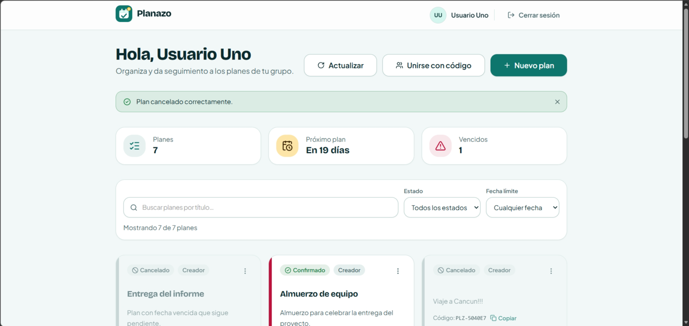
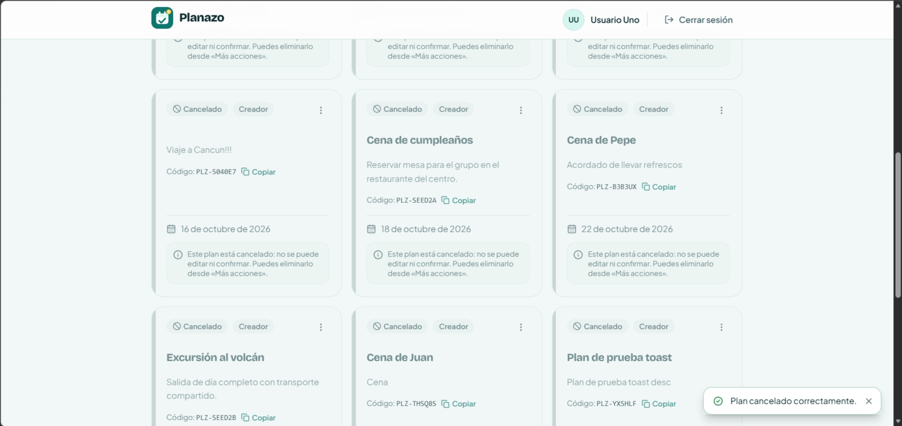
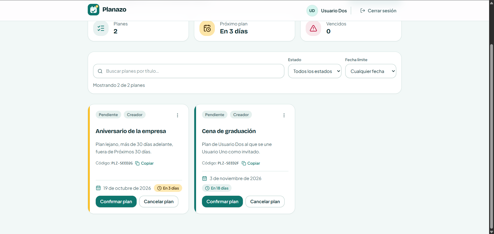
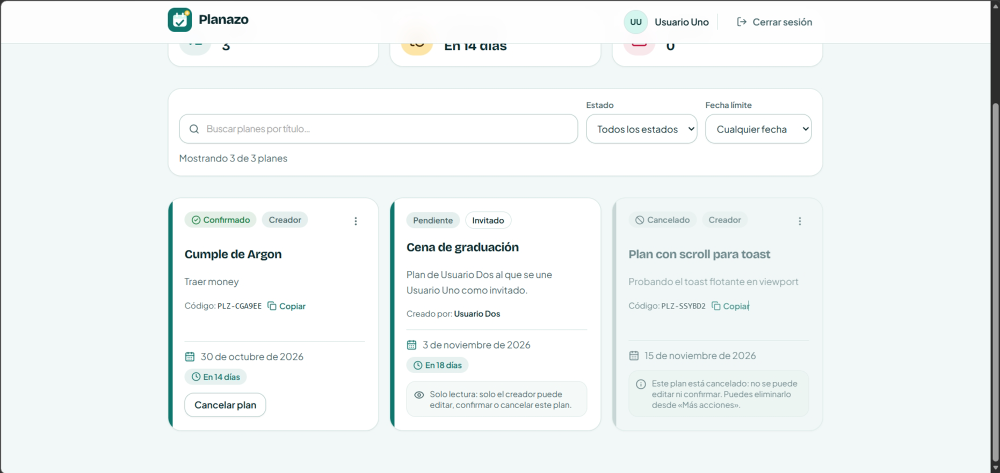
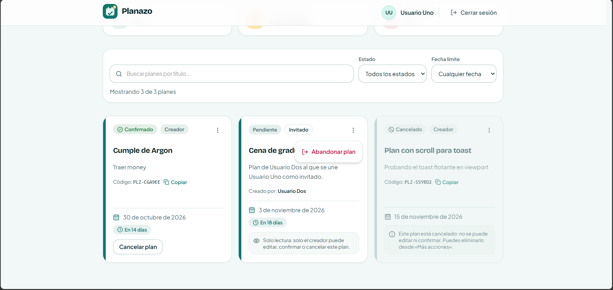
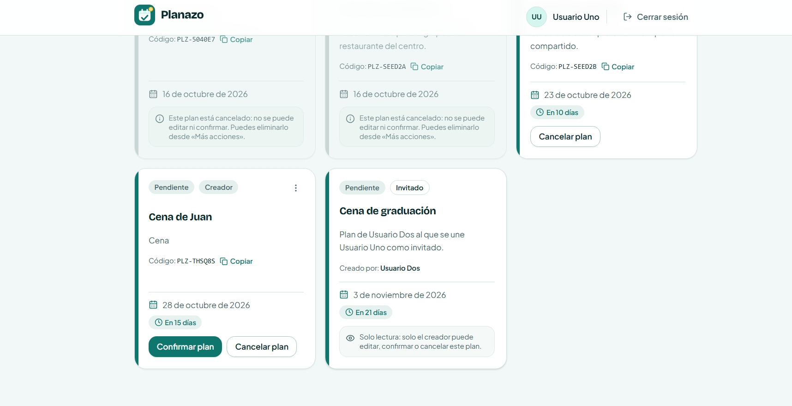

# Evaluación Heurística: Encontrar un Plan y Cancelarlo (H1 - H10)

**Asignatura:** Interacción Humano-Computador (IHC) · Clase 15  
**Proyecto:** Planazo  
**Funcionalidad Evaluada:** Encontrar un plan y cancelarlo (Búsqueda, filtrado y cancelación de planes)  
**Entrega:** Jueves 15 de octubre de 2026  

Este documento registra la evaluación de usabilidad centrada en la funcionalidad crítica **«Encontrar un plan y cancelarlo»**, aplicando las **10 Heurísticas de Jakob Nielsen**. La primera sección presenta el Resumen Ejecutivo con el diagnóstico real del código. La segunda sección detalla el Registro de Evidencias con referencias exactas al código fuente y capturas.

---

## 1. Resumen Ejecutivo (Tabla)

| Observación | Heurística | Severidad (0-4) | Mejora | Comprobación |
| :--- | :--- | :--- | :--- | :--- |
| **Al cancelar no aparece confirmación cerca de la acción:** Tras scrollear en la lista para encontrar el plan y confirmarlo en el modal, el aviso de éxito se renderizaba fuera del viewport. Corregido con toast contextual flotante anclado en pantalla. | **H1: Visibilidad del estado del sistema** 🟢 *(Corregida · Sub-issue #17)* | **0 — Corregida (antes 3)** | Notificación flotante accesible (`fixed bottom-5 right-5 z-50 shadow-lg`) anclada en viewport que confirma el estado «Cancelado» en cualquier posición de scroll. | Verificado con tests unitarios en `MyPlansPage.test.tsx` y captura de pantalla `H1-despues.png` con la lista scrolleada. |
| **Traducción adecuada a lenguaje cotidiano:** Las fechas de los planes a encontrar se expresan en lenguaje relativo coloquial (*"Vence en 3 días"*, *"Vence hoy"*), y las acciones usan términos comunes (*"Cancelar plan"*, *"Pasará a Cancelado"*). | **H2: Concordancia con el mundo real** ✅ *(Cumple en código)* | **0 — Sin problema** | Mantener vocabulario claro de reuniones y plazos sin requerir interpretación de marcas de tiempo ISO ni códigos de backend. | Un usuario lee la tarjeta encontrada y comprende de inmediato cuándo vence y en qué estado está sin consultar calendarios externos. |
| **Callejón sin salida para el invitado:** Si un usuario invitado busca y encuentra un plan al que se unió pero al que ya no puede asistir, la tarjeta solo mostraba un cartel de solo lectura sin opción de salida. Corregido con menú contextual y modal de abandono. | **H3: Control y libertad del usuario** 🟢 *(Corregida · Sub-issue #18)* | **0 — Corregida (antes 3)** | Habilitada la opción «Abandonar plan» en el menú (⋮) de la tarjeta de invitado con diálogo de confirmación (`ConfirmDialog`), toast contextual de feedback y desvinculación vía `POST /api/plans/:id/leave`. | Verificado con tests unitarios en backend y frontend (`PlanCard`, `PlanList`, `MyPlansPage`), typecheck limpio y capturas `H3-antes.png` y `H3-despues.png`. |
| **Uniformidad visual y funcional en botones y modales:** El botón «Cancelar plan» usa siempre la variante secundaria (`outline`) según DESIGN.md para no competir con el primario, y el menú (⋮) se ubica arriba a la derecha. | **H4: Consistencia y estándares** ✅ *(Cumple en código)* | **0 — Sin problema** | Respetar las variantes del sistema de diseño (`tokens.css`, `Button.tsx`, `ConfirmDialog.tsx`) de forma idéntica en todas las tarjetas de la lista. | El usuario escanea la grilla de planes encontrados e identifica de inmediato qué botón cancela y cuál confirma sin dudar. |
| **Prevención activa contra cancelaciones accidentales:** El sistema exige confirmación explícita mediante un modal destructivo que nombra el título del plan, y deshabilita la acción si el plan ya estaba cancelado. | **H5: Prevención de errores** ✅ *(Cumple en código)* | **0 — Sin problema** | Diálogo modal de doble confirmación con el nombre entre comillas y bloqueo del botón para planes ya cancelados (`PlanCard.tsx:L241-L248`). | Un usuario pulsa «Cancelar plan» por error y aborta la acción pulsando «Cancelar» o la tecla `Esc` sin perder datos. |
| **Visibilidad de filtros y datos clave al buscar:** Los filtros activos de estado y fecha se muestran como etiquetas visibles (*chips*) removibles, y la tarjeta exhibe el nombre y la fecha sin tener que memorizarlos. | **H6: Reconocimiento antes que recuerdo** ✅ *(Cumple en código)* | **0 — Sin problema** | Mantener las opciones de búsqueda y los datos clave a la vista para evitar que el usuario deba recordar qué filtros aplicó. | El usuario encuentra su plan y sabe exactamente qué criterios de búsqueda están activos observando los chips de la cabecera. |
| **Eficiencia de búsqueda combinada y persistencia en URL:** Búsqueda en tiempo real por texto combinable con filtros de estado (`pendientes`, `confirmados`, `cancelados`) sincronizados en `searchParams`. | **H7: Flexibilidad y eficiencia de uso** ✅ *(Cumple en código)* | **0 — Sin problema** | Sincronización bidireccional en URL para que usuarios frecuentes compartan enlaces con planes ya filtrados o usen el historial. | Un usuario copia el enlace filtrado de planes pendientes, lo abre en otra ventana y localiza el plan al instante. |
| **Redundancia visual al escanear la lista de planes:** Todas las tarjetas propias muestran la insignia «Creador», saturando visualmente la cabecera de la grilla al buscar un plan. | **H8: Estética y diseño minimalista** ❌ *(Falla · Sub-issue #19)* | **1 — Cosmético** | Retirar la insignia fija «Creador» en planes propios (mostrando solo «Invitado» en ajenos) y compactar las notas de bloqueo. | El usuario escanea la lista de planes y localiza el plan a cancelar con menor fatiga visual y cabeceras más limpias. |
| **Recuperación inmediata si la búsqueda no arroja resultados:** Si el usuario busca un plan y no hay coincidencias, se explica el motivo y se ofrece un botón directo «Limpiar filtros». | **H9: Ayudar a recuperarse de errores** ✅ *(Cumple en código)* | **0 — Sin problema** | Mensaje orientativo en pantalla vacía con botón de recuperación de 1 clic para restablecer la vista sin recargar. | El usuario escribe un término sin resultados, hace clic en «Limpiar filtros» y recupera la lista completa inmediatamente. |
| **Orientación sobre el impacto de la cancelación:** El modal de confirmación explica qué significa cancelar (*"«Plan» pasará a Cancelado. Podrás eliminarlo una vez cancelado"*). | **H10: Ayuda y documentación** ✅ *(Cumple en código)* | **0 — Sin problema** | Textos explicativos en el diálogo modal y avisos preventivos en la tarjeta cancelada indicando las acciones disponibles. | El usuario lee la descripción del modal antes de cancelar y comprende las consecuencias sin consultar ayuda externa. |

---

### Escala de Severidad de Nielsen (0 a 4)

* **0 — No es problema de usabilidad:** Cumple satisfactoriamente la heurística en la funcionalidad evaluada.
* **1 — Cosmético:** Detalle visual o estético menor; se corrige si hay tiempo disponible.
* **2 — Menor:** Dificulta levemente la tarea, pero permite al usuario continuar sin bloqueo.
* **3 — Mayor:** Problema importante de usabilidad; genera confusión o incertidumbre grave en el flujo.
* **4 — Catastrófico:** Bloquea por completo la tarea de encontrar o cancelar el plan.

---

## 2. Registro de Evidencias por Heurística (H1 a H10)

### H1: Visibilidad del estado del sistema

* **Estado:** 🟢 **Corregida (Resuelto en Sub-issue #17)**
* **Severidad:** **0 — Corregida (original: 3 — Mayor)**
* **Pantalla y flujo:** Catálogo de planes en `/mis-planes`. Paso: el usuario busca un plan en la lista, hace scroll hacia abajo, pulsa «Cancelar plan» y confirma en el diálogo modal.
* **Problema en código previo (Antes):** En [MyPlansPage.tsx](file:///d:/Proyectos/Proyectos-Moises/Proyecto-2-IHC/apps/frontend/src/pages/MyPlansPage.tsx), el componente `SuccessNotice` estaba insertado estáticamente arriba en el layout. Al confirmar la cancelación con scroll, el modal se cerraba pero el mensaje quedaba oculto arriba fuera del viewport.
* **Solución implementada (Después):** Se encapsuló `SuccessNotice` en [MyPlansPage.tsx:L175-L179](file:///d:/Proyectos/Proyectos-Moises/Proyecto-2-IHC/apps/frontend/src/pages/MyPlansPage.tsx#L175-L179) dentro de un contenedor flotante anclado al viewport (`fixed bottom-5 right-5 z-50 max-w-[calc(100vw-2.5rem)] sm:max-w-md shadow-lg animate-in fade-in slide-in-from-bottom-2 duration-200`) y se aseguró el fondo opaco `bg-card` en [Notices.tsx:L40](file:///d:/Proyectos/Proyectos-Moises/Proyecto-2-IHC/apps/frontend/src/components/domain/Notices.tsx#L40), garantizando visibilidad inmediata e inequívoca tras la cancelación sin importar la posición de scroll.
* **Referencia al código:** [MyPlansPage.tsx:L175-L179](file:///d:/Proyectos/Proyectos-Moises/Proyecto-2-IHC/apps/frontend/src/pages/MyPlansPage.tsx#L175-L179) y [Notices.tsx:L40](file:///d:/Proyectos/Proyectos-Moises/Proyecto-2-IHC/apps/frontend/src/components/domain/Notices.tsx#L40).
* **Evidencias gráficas:**
  * *Antes (Secuencia de falla: falta de feedback contextual con scroll):*  
    * **Paso 1 (Modal de cancelación tras scroll):**  
        
    * **Paso 2 (Ausencia de feedback en viewport tras confirmar):**  
        
    * **Paso 3 (Scroll forzado hasta el tope para ver el mensaje):**  
      
  * *Después (Notificación toast flotante en viewport tras el fix):*  
    * **Confirmación flotante visible en viewport con scroll activo:**  
      

---

### H2: Concordancia entre el sistema y el mundo real

* **Estado:** ✅ **Cumple en código**
* **Severidad:** **0 — No es problema**
* **Pantalla y flujo:** Catálogo de planes y diálogo de cancelación. Paso: el usuario busca un plan por su fecha y lee las opciones disponibles.
* **Comprobación en código actual:** En [plans.ts:L31-L47](file:///d:/Proyectos/Proyectos-Moises/Proyecto-2-IHC/apps/frontend/src/lib/plans.ts#L31-L47), la función `formatDueDate` formatea las fechas a *"Vence en 3 días"*, *"Vence hoy"*, etc. En [PlanCard.tsx:L229](file:///d:/Proyectos/Proyectos-Moises/Proyecto-2-IHC/apps/frontend/src/components/domain/PlanCard.tsx#L229), el botón indica claramente *"Cancelar plan"* y el modal en [PlanCard.tsx:L280](file:///d:/Proyectos/Proyectos-Moises/Proyecto-2-IHC/apps/frontend/src/components/domain/PlanCard.tsx#L280) explica que *"pasará a Cancelado"*, sin tecnicismos de base de datos.
* **Referencia al código:** [plans.ts:L31-L47](file:///d:/Proyectos/Proyectos-Moises/Proyecto-2-IHC/apps/frontend/src/lib/plans.ts#L31-L47) y [PlanCard.tsx:L207-L213](file:///d:/Proyectos/Proyectos-Moises/Proyecto-2-IHC/apps/frontend/src/components/domain/PlanCard.tsx#L207-L213).
* **Evidencia gráfica:**  
  

---

### H3: Control y libertad del usuario

* **Estado:** 🟢 **Corregida (Resuelto en Sub-issue #18)**
* **Severidad:** **0 — Corregida (original: 3 — Mayor)**
* **Pantalla y flujo:** Catálogo de planes `/mis-planes`, tarjeta de plan con rol «Invitado». Paso: el usuario invitado busca un plan al que se unió para cancelar su participación y retirarse del plan.
* **Problema en código previo (Antes):** En [PlanCard.tsx](file:///d:/Proyectos/Proyectos-Moises/Proyecto-2-IHC/apps/frontend/src/components/domain/PlanCard.tsx), si `!isOwner`, la tarjeta solo mostraba una nota pasiva de solo lectura y el menú de opciones (⋮) solo se renderizaba para el dueño (`isOwner`), dejando al invitado en un callejón sin salida sin opción de retirarse ni en la interfaz ni en el backend.
* **Solución implementada (Después):** Se expuso el menú de acciones (⋮) también para usuarios con rol invitado conteniendo la opción destructiva «Abandonar plan» conectada a un `ConfirmDialog` preventivo («¿Abandonar este plan?»), respaldado por el endpoint `POST /api/plans/:id/leave` en backend y `usePlans.leavePlan` en frontend, mostrando el aviso flotante «Has abandonado el plan.» y retirando la tarjeta de la vista sin recargar la página.
* **Referencia al código:** [PlanCard.tsx:L168-L175](file:///d:/Proyectos/Proyectos-Moises/Proyecto-2-IHC/apps/frontend/src/components/domain/PlanCard.tsx#L168-L175), [PlanCard.tsx:L314-L327](file:///d:/Proyectos/Proyectos-Moises/Proyecto-2-IHC/apps/frontend/src/components/domain/PlanCard.tsx#L314-L327), [plans.ts:L222-L242](file:///d:/Proyectos/Proyectos-Moises/Proyecto-2-IHC/apps/backend/src/routes/plans.ts#L222-L242) y [plans.service.ts:L419-L430](file:///d:/Proyectos/Proyectos-Moises/Proyecto-2-IHC/apps/backend/src/services/plans.service.ts#L419-L430).
* **Evidencias gráficas:**
  * *Antes (Tarjeta de invitado sin opción para retirarse):*  
    
  * *Después (Menú contextual con opción «Abandonar plan» y confirmación):*  
    

---

### H4: Consistencia y estándares

* **Estado:** ✅ **Cumple en código**
* **Severidad:** **0 — No es problema**
* **Pantalla y flujo:** Barra de búsqueda, grilla de planes y modal de confirmación. Paso: interactuar con los botones de acción para cancelar.
* **Comprobación en código actual:** Se alinea estrictamente con [DESIGN.md:L67](file:///d:/Proyectos/Proyectos-Moises/Proyecto-2-IHC/apps/frontend/DESIGN.md#L67). En la tarjeta, «Cancelar plan» usa `variant="outline"` ([PlanCard.tsx:L228](file:///d:/Proyectos/Proyectos-Moises/Proyecto-2-IHC/apps/frontend/src/components/domain/PlanCard.tsx#L228)) para no competir con el botón primario `default`. El color destructivo rojo (`destructive`) se reserva exclusivamente para el botón de confirmación final dentro del diálogo modal ([ConfirmDialog.tsx:L50-L60](file:///d:/Proyectos/Proyectos-Moises/Proyecto-2-IHC/apps/frontend/src/components/domain/ConfirmDialog.tsx#L50-L60)). El menú (⋮) se posiciona siempre arriba a la derecha.
* **Referencia al código:** [DESIGN.md:L67-L70](file:///d:/Proyectos/Proyectos-Moises/Proyecto-2-IHC/apps/frontend/DESIGN.md#L67-L70), [tokens.css](file:///d:/Proyectos/Proyectos-Moises/Proyecto-2-IHC/apps/frontend/src/tokens.css) y [PlanCard.tsx:L228-L238](file:///d:/Proyectos/Proyectos-Moises/Proyecto-2-IHC/apps/frontend/src/components/domain/PlanCard.tsx#L228-L238).
* **Evidencia gráfica:**  
  

---

### H5: Prevención de errores

* **Estado:** ✅ **Cumple en código**
* **Severidad:** **0 — No es problema**
* **Pantalla y flujo:** Acción de cancelar en la tarjeta de plan. Paso: pulsar el botón «Cancelar plan».
* **Comprobación en código actual:** En [PlanCard.tsx:L274-L287](file:///d:/Proyectos/Proyectos-Moises/Proyecto-2-IHC/apps/frontend/src/components/domain/PlanCard.tsx#L274-L287), la cancelación exige confirmar en un `ConfirmDialog` modal que cita el nombre del plan entre comillas. En [PlanCard.tsx:L239-L249](file:///d:/Proyectos/Proyectos-Moises/Proyecto-2-IHC/apps/frontend/src/components/domain/PlanCard.tsx#L239-L249), cuando el plan ya está cancelado, el botón desaparece y se muestra una nota estática, impidiendo cancelar dos veces por error.
* **Referencia al código:** [PlanCard.tsx:L239-L249](file:///d:/Proyectos/Proyectos-Moises/Proyecto-2-IHC/apps/frontend/src/components/domain/PlanCard.tsx#L239-L249) y [PlanCard.tsx:L274-L287](file:///d:/Proyectos/Proyectos-Moises/Proyecto-2-IHC/apps/frontend/src/components/domain/PlanCard.tsx#L274-L287).
* **Evidencia gráfica:**  
  `docs/evidencias/H5-modal-confirmacion.png` *(captura del modal con confirmación del título)*

---

### H6: Reconocimiento antes que recuerdo

* **Estado:** ✅ **Cumple en código**
* **Severidad:** **0 — No es problema**
* **Pantalla y flujo:** Barra de filtros y modal de cancelación. Paso: filtrar la lista para encontrar el plan y abrir el modal.
* **Comprobación en código actual:** En [PlanFiltersBar.tsx:L40-L60](file:///d:/Proyectos/Proyectos-Moises/Proyecto-2-IHC/apps/frontend/src/components/domain/PlanFiltersBar.tsx#L40-L60), los filtros activos se visualizan como chips con botón de cierre (X). En [PlanCard.tsx:L280](file:///d:/Proyectos/Proyectos-Moises/Proyecto-2-IHC/apps/frontend/src/components/domain/PlanCard.tsx#L280), el diálogo modal repite explícitamente el nombre del plan a cancelar (*"«Cena del viernes» pasará a Cancelado"*), evitando que el usuario deba recordarlo.
* **Referencia al código:** [PlanFiltersBar.tsx:L40-L60](file:///d:/Proyectos/Proyectos-Moises/Proyecto-2-IHC/apps/frontend/src/components/domain/PlanFiltersBar.tsx#L40-L60) y [PlanCard.tsx:L280](file:///d:/Proyectos/Proyectos-Moises/Proyecto-2-IHC/apps/frontend/src/components/domain/PlanCard.tsx#L280).
* **Evidencia gráfica:**  
  `docs/evidencias/H6.png` *(captura de chips activos y confirmación del plan)*

---

### H7: Flexibilidad y eficiencia de uso

* **Estado:** ✅ **Cumple en código**
* **Severidad:** **0 — No es problema**
* **Pantalla y flujo:** Barra de búsqueda y filtrado de planes. Paso: buscar por texto y filtrar por estado simultáneamente.
* **Comprobación en código actual:** En [MyPlansPage.tsx:L52-L62](file:///d:/Proyectos/Proyectos-Moises/Proyecto-2-IHC/apps/frontend/src/pages/MyPlansPage.tsx#L52-L62), los criterios de búsqueda y filtros se sincronizan bidireccionalmente con `searchParams` en la URL. Esto permite guardar búsquedas frecuentes en marcadores del navegador o compartir enlaces con planes ya filtrados.
* **Referencia al código:** [PlanFiltersBar.tsx:L60-L120](file:///d:/Proyectos/Proyectos-Moises/Proyecto-2-IHC/apps/frontend/src/components/domain/PlanFiltersBar.tsx#L60-L120) y [MyPlansPage.tsx:L52-L62](file:///d:/Proyectos/Proyectos-Moises/Proyecto-2-IHC/apps/frontend/src/pages/MyPlansPage.tsx#L52-L62).
* **Evidencia gráfica:**  
  `docs/evidencias/H7.png` *(captura con parámetros de búsqueda en la URL)*

---

### H8: Estética y diseño minimalista

* **Estado:** ❌ **Falla (A resolver en Sub-issue #19)**
* **Severidad:** **1 — Cosmético**
* **Pantalla y flujo:** Grilla de tarjetas en `/mis-planes`. Paso: escanear la lista para localizar el plan a cancelar.
* **Problema en código actual (Antes):** En [PlanCard.tsx:L142-L149](file:///d:/Proyectos/Proyectos-Moises/Proyecto-2-IHC/apps/frontend/src/components/domain/PlanCard.tsx#L142-L149), el código renderiza `<Badge variant="muted">Creador</Badge>` en todos los planes propios. Esto sobrecarga visualmente la cabecera con una etiqueta redundante (el usuario ya sabe que son sus planes) y genera fatiga visual innecesaria al escanear la lista.
* **Solución propuesta (Después):** Omitir la badge «Creador» en planes propios (`!isOwner ? <Badge variant="outline">Invitado</Badge> : null`) para despejar la cabecera.
* **Referencia al código:** [PlanCard.tsx:L142-L149](file:///d:/Proyectos/Proyectos-Moises/Proyecto-2-IHC/apps/frontend/src/components/domain/PlanCard.tsx#L142-L149) y [DESIGN.md:L47-L50](file:///d:/Proyectos/Proyectos-Moises/Proyecto-2-IHC/apps/frontend/DESIGN.md#L47-L50).
* **Evidencias gráficas:**
  * *Antes (Insignia fija repetitiva «Creador» en cada tarjeta):*  
    `docs/evidencias/H8-antes.png` *(captura de la grilla con badge redundante)*
  * *Después (Cabecera limpia y escaneo ágil):*  
    `docs/evidencias/H8-despues.png` *(se captura al aplicar el fix del sub-issue #19)*

---

### H9: Ayudar a los usuarios a reconocer, diagnosticar y recuperarse de errores

* **Estado:** ✅ **Cumple en código**
* **Severidad:** **0 — No es problema**
* **Pantalla y flujo:** Búsqueda sin resultados en `/mis-planes`. Paso: escribir un término de búsqueda que no coincide con ningún plan.
* **Comprobación en código actual:** En [PlanList.tsx:L28-L49](file:///d:/Proyectos/Proyectos-Moises/Proyecto-2-IHC/apps/frontend/src/components/domain/PlanList.tsx#L28-L49), cuando ningún plan coincide con la búsqueda o filtro, se muestra el estado `"no-match"` con un mensaje claro en español (*"No hay planes que coincidan con los filtros"*) y el botón directo `Limpiar filtros` (`onClearFilters`) para restablecer la vista sin recargar.
* **Referencia al código:** [PlanList.tsx:L28-L49](file:///d:/Proyectos/Proyectos-Moises/Proyecto-2-IHC/apps/frontend/src/components/domain/PlanList.tsx#L28-L49).
* **Evidencia gráfica:**  
  `docs/evidencias/H9-recuperacion-filtros.png` *(captura del empty state con botón de limpieza)*

---

### H10: Ayuda y documentación

* **Estado:** ✅ **Cumple en código**
* **Severidad:** **0 — No es problema**
* **Pantalla y flujo:** Tarjeta de plan cancelado y diálogo modal. Paso: leer la información contextual antes y después de cancelar.
* **Comprobación en código actual:** En [PlanCard.tsx:L279-L281](file:///d:/Proyectos/Proyectos-Moises/Proyecto-2-IHC/apps/frontend/src/components/domain/PlanCard.tsx#L279-L281), el diálogo modal explica previamente que el plan pasará a cancelado y que podrá eliminarse luego. En [PlanCard.tsx:L241-L248](file:///d:/Proyectos/Proyectos-Moises/Proyecto-2-IHC/apps/frontend/src/components/domain/PlanCard.tsx#L241-L248), la tarjeta cancelada muestra la nota con `role="note"` que informa que ya no se puede editar ni confirmar pero sí eliminar desde «Más acciones».
* **Referencia al código:** [PlanCard.tsx:L241-L248](file:///d:/Proyectos/Proyectos-Moises/Proyecto-2-IHC/apps/frontend/src/components/domain/PlanCard.tsx#L241-L248) y [PlanCard.tsx:L279-L281](file:///d:/Proyectos/Proyectos-Moises/Proyecto-2-IHC/apps/frontend/src/components/domain/PlanCard.tsx#L279-L281).
* **Evidencia gráfica:**  
  `docs/evidencias/H10-ayuda-cancelacion.png` *(captura de la tarjeta cancelada con nota explicativa)*

---

## 3. Sub-issues y Trazabilidad de Correcciones

Para la funcionalidad **«Encontrar un plan y cancelarlo»**, los hallazgos que fallan en el código actual se gestionan en los siguientes sub-issues atómicos:

| Heurística | Sub-issue | Commit de Cierre | Archivos a Modificar |
| :--- | :--- | :--- | :--- |
| **H1** | `#17` · Feedback visible y contextual al cancelar planes | `fix: ensure visible contextual feedback on plan cancellation (Closes #17, Refs #16)` | `apps/frontend/src/pages/MyPlansPage.tsx`, `Notices.tsx` |
| **H3** | `#18` · Salida de emergencia para invitados en planes compartidos | `fix: add leave plan emergency exit for guest members (Closes #18, Refs #16)` | `apps/frontend/src/components/domain/PlanCard.tsx`, `usePlans.ts` |
| **H8** | `#19` · Eliminación de redundancia visual en insignias de tarjetas | `fix: remove redundant owner badge and streamline card minimalism (Closes #19, Refs #16)` | `apps/frontend/src/components/domain/PlanCard.tsx`, `PlanCard.test.tsx` |
